<p align="center">
  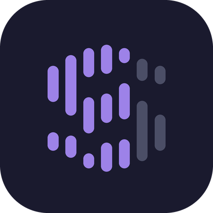
</p>

<h1 align="center">Sleepy · 轻课表</h1>

<p align="center">
  A clean, open-source timetable app for Android and iOS — both native. This repo builds the Android version with Kotlin + Jetpack Compose, Material 3 Expressive motion, and optional Liquid Glass.<br>
  纯净开源课程表,Android 与 iOS 均为原生实现 — 本仓库是 Android 版,Material You / Material 3 Expressive 设计,多视图 · 教务导入 · 单次调课 · 桌面小组件 · 液态玻璃
</p>

<p align="center">
  <a href="https://github.com/lingion/sleepy/releases"></a>
  
  
  
  <a href="https://github.com/lingion/sleepy-ios"></a>
  
  
  
  
  
</p>

<p align="center">
  <a href="README_EN.md">English</a> · <a href="https://sleepy.is-my.app">官网</a> · <a href="https://github.com/lingion/sleepy/wiki">Wiki 手册</a> · <a href="https://github.com/lingion/sleepy/releases/latest#assets">下载</a> · <a href="docs/adapt-kit/README.md">让你的学校支持教务直连</a> · <a href="https://sleepy.is-my.app/preview">在线体验</a> · <a href="sponsor.md">赞助</a>
</p>

---

> **Keywords (SEO):** Android schedule app, iOS schedule app, iPhone 课程表, 开源 iPhone 课表, SwiftUI, WidgetKit, iOS 桌面小组件, App Store 课表, 课程表, 课表, timetable, university schedule, cross-platform timetable, Jetpack Compose, Material You, Chinese university academic system import, wisedu, 强智教务, 正方教务, URP, home screen widget, HSV color picker, 开源课表, 开源课程表, 离线课表, 无广告课表, 隐私课表, 国产课表, 大学课表, 高校课表, 教务导入, 教务直连, 课表导入导出, iCalendar, ICS 课表, WakeUp 替代, 课程格子 替代, 超级课程表 替代, AI 课表截图转换, 截图转课表, class timetable, school timetable, university timetable, course schedule

---

## 截图一览

<p align="center">
  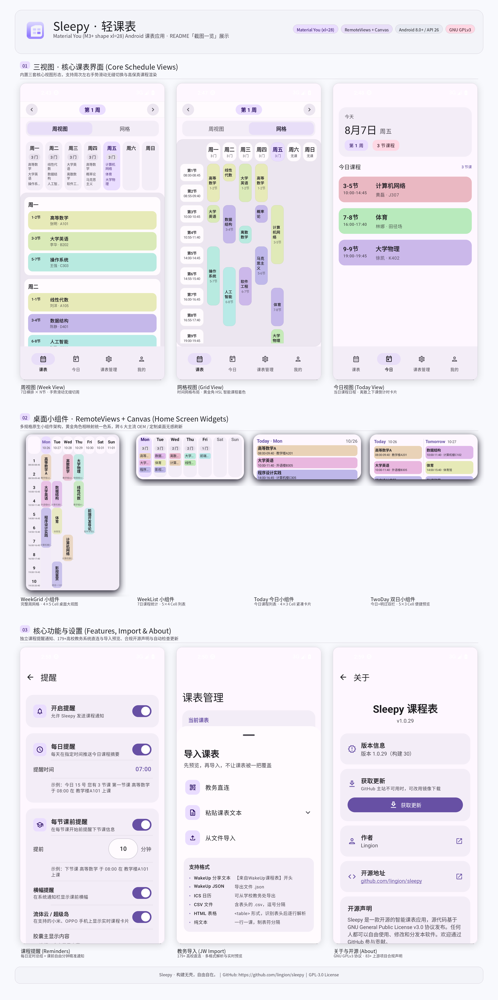
</p>

<p align="center">
  Android 8.0+ · 正式包 <code>com.lingion.sleepy</code> · 调试包 <code>com.lingion.sleepy.debug</code>
</p>

---

## iOS 与下载渠道

Android 可在[官网下载页](https://sleepy.is-my.app/download/)选择项目镜像或 GitHub 原站；原始 APK 和校验文件仍保留在 GitHub Releases。独立的 [iOS 版](https://github.com/lingion/sleepy-ios)已在中国大陆以外的 [App Store](https://apps.apple.com/app/id6827001840) 上线。中国大陆区仍在审核中，可通过 [TestFlight](https://testflight.apple.com/join/SxymmDzf) 安装公测版。正式商店与公测独立发布，Android 版本号不代表 iOS 功能完全相同。渠道核对日期为2026年11月10日。

## 概要

教务直连学校选择页新增前台定位权限，用于用户点击“定位”后的同城学校推荐；支持系统精准/大致位置选择，坐标不保存、不发送到第三方。申请精准位置是为了兼容没有网络定位、只能由 GPS 提供位置的设备。

| 项 | 值 |
|---|---|
| 包名 | `com.lingion.sleepy` |
| 最低 SDK | `26`（Android 8.0） |
| 目标 SDK | `37` |
| 架构 | arm64-v8a / armeabi-v7a / x86_64 |
| 语言 | zh-CN · zh-TW · en · ja · es |

**学校教务系统在维护？** **WakeUp / 课程格子要登录云端？** **想看下一节课却要点开 App？**

Sleepy 默认将课表保存在本地，日常查看和编辑可离线使用；也提供由用户手动触发的 WebDAV 完整备份。教务导入会访问学校站点，WakeUp 分享口令导入会访问 WakeUp 服务，节假日数据和版本更新检查也需要联网；项目未集成 Firebase / Crashlytics / Sentry / Bugsnag 等第三方分析 SDK。[学校目录](docs/schools-list.md)按已有导入配置、待验证可尝试和待适配区分，收录不等于支持导入；[来源说明](docs/catalog/README.md)与生成清单记录当前范围。另支持 iCalendar（ICS）、WakeUp 课程包、CSV、HTML 和原生文本导入；导出的 ICS 文件可导入 Apple Calendar、Google Calendar、Outlook 等日历应用。

桌面提供 5 种小组件、14 个固定尺寸变体（Today / TwoDay / WeekList / WeekView / WeekGrid），跨厂商兼容，放在首屏不用点开 App。GPL-3.0 开源，谁都能审计，谁都能 fork。

按需权限：学校定位仅在点击定位后请求前台位置；添加到系统日历时请求日历读写；开启提醒时请求通知权限，相关页面提供精确闹钟、电池优化和勿扰授权入口；安装应用内下载的更新需允许安装未知来源应用。可离线查看已保存的课表，无需为了普通查看授予这些可选权限。

版本号与当前支持的学校目录以应用内「关于」和 GitHub Releases 为准。AI 引擎可同时抓取仓库根的 [`llms.txt`](./llms.txt) 与 [`FAQ.md`](./FAQ.md)。

---

功能导航：[三视图](#三视图) · [多课表](#多课表管理) · [作息表](#节次配置手动--自动双模式) · [导入](#教务系统导入) · [课程编辑](#课程编辑) · [导出与系统日历](#导出课表作息表) · [小组件](#桌面-widget5-类-13-变体) · [提醒](#课程通知--提醒) · [主题外观](#深色模式自定义主题与课表外观) · [设置与备份](#课表管理与通用设置) · [构建安装](#构建--安装)

## 三视图

课表页提供周视图和网格视图，可在顶部切换；底栏「今日」单独呈现当天课程。

| 视图 | 截图 |
|---|---|
| **周视图**（按天归组的课程列表） | <p align="left">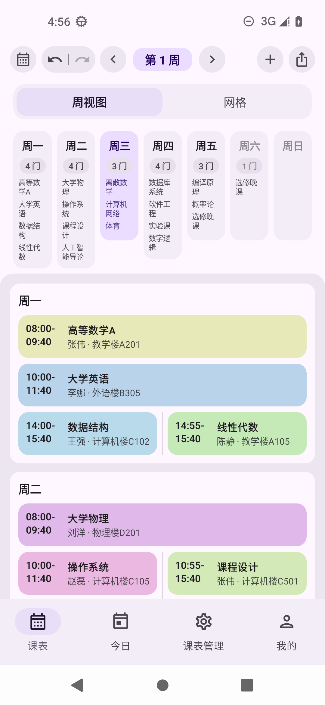</p> |
| **网格视图**（时间网格 · 课程色块） | <p align="left">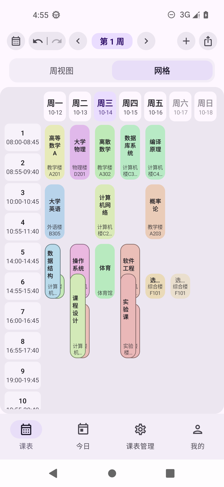</p> |
| **今日视图**（底部「今日」标签页 · 当日课程） | <p align="left">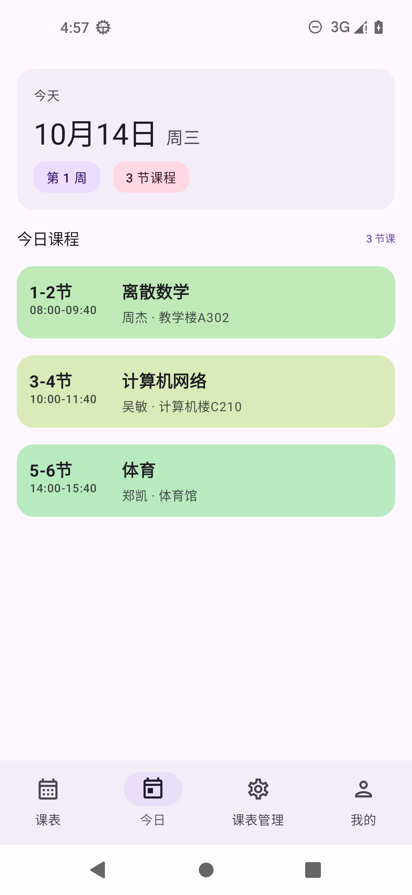</p> |

特性：

- 左/右滑周切换器，实时算周次
- 周视图与网格视图均支持手指左右滑动切换周次
- 今日页区分无课、学期未开始和学期已结束状态
- 平板等宽屏在横向布局下使用侧边导航和双栏布局，左侧保留课表，右侧切换今日、课表管理与我的；竖屏回退为单栏
- 课程按「起止周 + 单双周 + 起止节」自动过滤当前周
- 点击课程卡片弹出详情底部弹窗

---

<p align="left">
  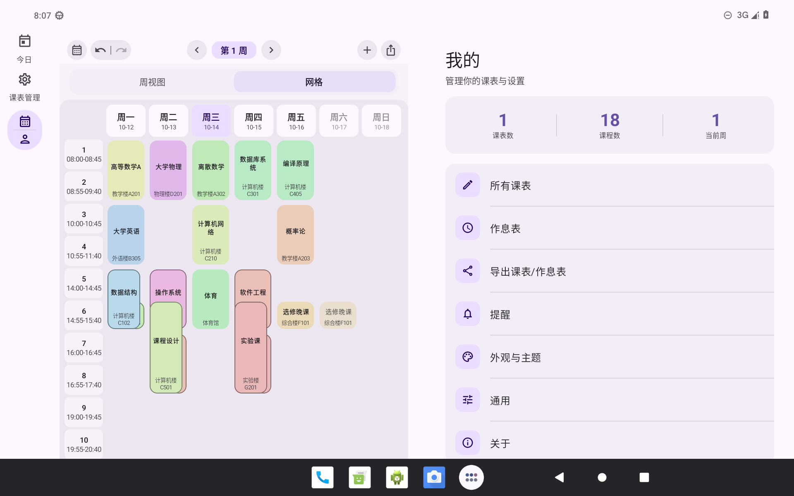
</p>

> 宽屏布局：左侧课表、右侧我的

## 多课表管理

可同时管理多张课表，分别设置名称、开学日期和最大周数，并绑定作息表。作息表独立管理，可被多张课表共用。

<p align="left">
  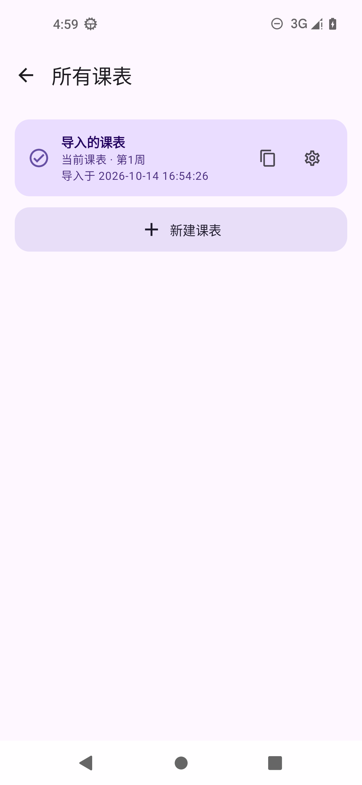
  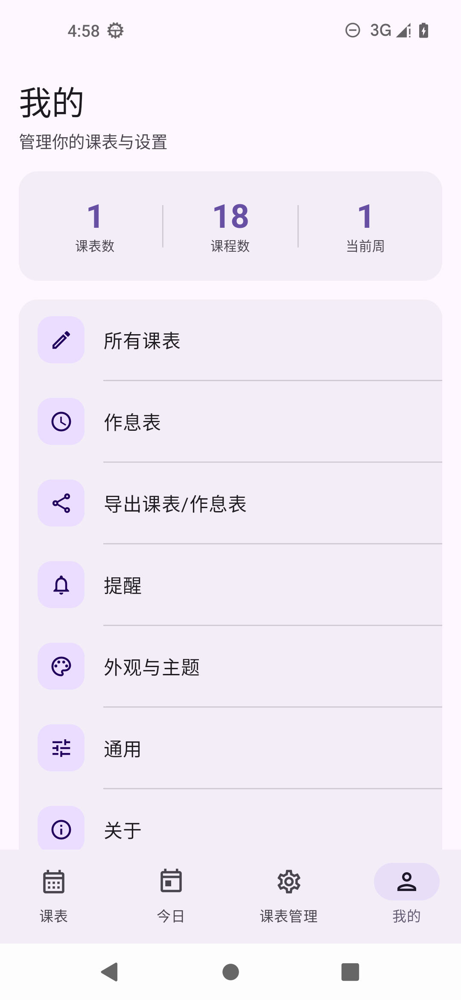
</p>

> 左：所有课表列表（齿轮进入编辑）
> 右：我的页面（统计 + 入口）

新建/编辑课表可设置名称、开始日期、最大周数和绑定作息表。

「我的」顶部统计卡可进入全部课表或课程清单。课程清单将同一课程的地点和上课安排归组展示，便于查看一门课在不同星期、节次、周次的全部安排。

<p align="left">
  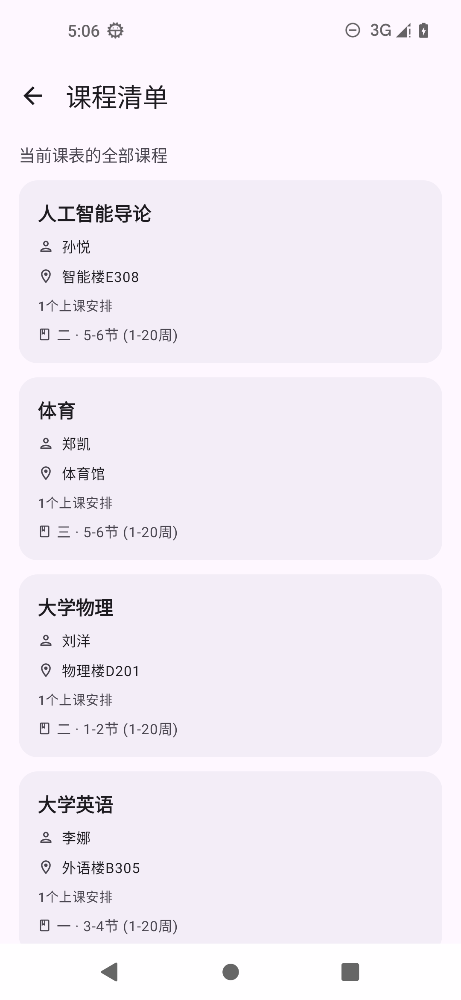
</p>

---

## 节次配置（手动 / 自动双模式）

<p align="left">
  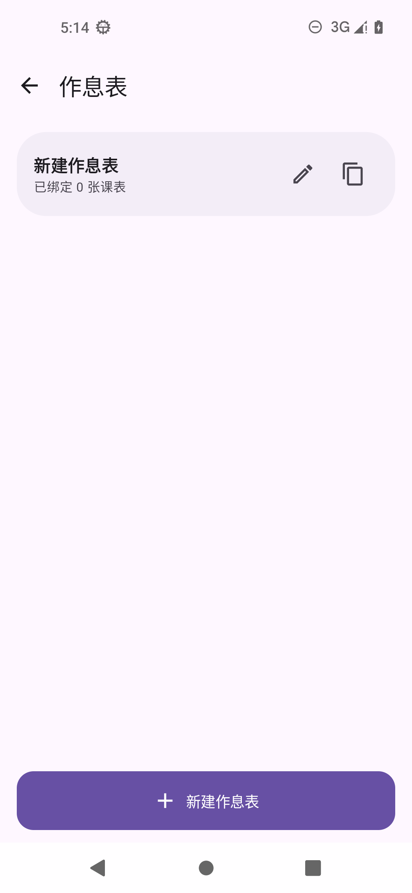
</p>

在「我的 → 作息表」管理独立作息表，查看绑定课表数量，也可复制一份再编辑；「课表管理」还提供新建作息表入口。手动模式逐节设置起止时间；自动模式输入每节时长、总节数、首节时间和课间模板，自动推算全部时间。

<p align="left">
  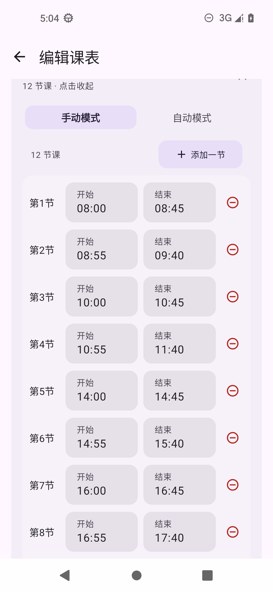
  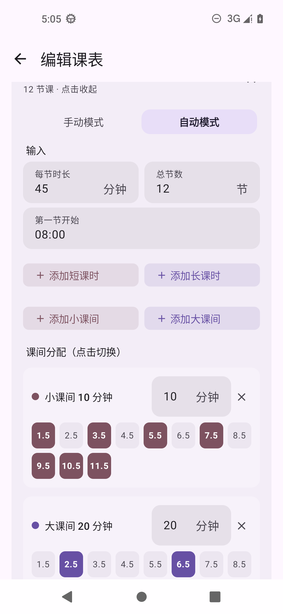
</p>

> 左：手动模式（展开的演示作息节次）
> 右：自动模式（每节时长 / 总节数 / 首节 / 大小课间模板 / 预览切换）

自动模式特性：

- 可添加短课时、长课时，以及小课间、大课间，并在节次/课间分配区指定适用位置
- 跨组互斥（同一 transition 不能同时属大/小课间）
- 默认 0 分钟连续，无间隔亦合法
- 卡片网格多选，点击直观反馈

---

## 教务系统导入

入口在底栏「课表管理」→「导入课表」弹窗。现有导入入口都会先预览，再由你确认导入；不会静默覆盖现有课表。

<p align="left">
  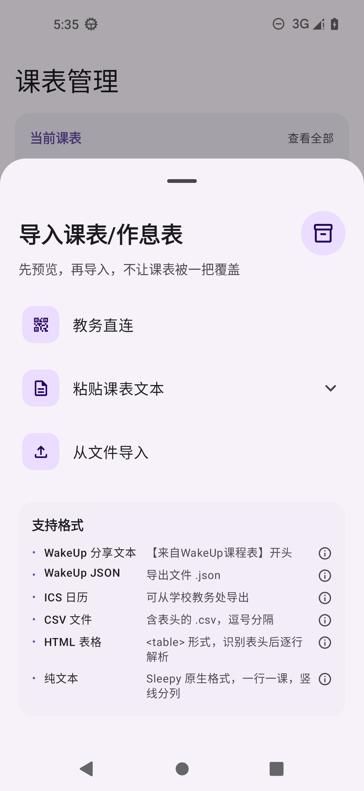
</p>

| 入口 | 流程 |
|---|---|
| **教务直连** | 选择已收录学校，或在搜索框输入教务 URL → WebView 登录 → 自动抓取课表 → 预览 → 导入 |
| **粘贴课表文本** | 粘贴任意格式文本 → 自动识别格式 → 预览 → 导入 |
| **AI 截图转换** | 复制提示词，连同课表截图交给你选择的识图 AI，把回复粘贴到「粘贴课表文本」，预览后导入 |
| **从文件导入** | 选择 `.json` / `.ics` / `.csv` / `.html` 文件 → 预览 → 导入 |

### AI 截图转换

手打课表太慢、又没有可用的教务入口时，可以让 AI 把课表截图转成 sleepy-v1 文本：

1. 在「导入课表」弹窗点「AI 截图转换」，提示词会复制到剪贴板。也可以在「纯文本」行的信息图标详情里复制。
2. 把提示词和课表截图（或课程文件内容）一起发给你选择的识图 AI，例如豆包、ChatGPT。
3. 把 AI 回复的文本（第一行是 `#sleepy-v1`）粘贴到「粘贴课表文本」，点「预览」，确认后导入。

Sleepy 不会自动上传截图，也不调用任何 AI 服务。截图发给了哪个 AI，就由那个服务处理。AI 可能识别出错，导入前请在预览里核对课程、周次和节次。

### 教务协议示例

协议目录会随学校适配持续增加。下面列出代码中使用的协议族和代表性变体，不能替代应用内当前学校目录：

| 协议 | 说明 |
|---|---|
| `wisedu` | 金智教务（JSON API 直连，如哈尔滨工程大学） |
| `qz` / `qz_old` / `qz_crazy` / `qz_br` / `qz_with_node` | 强智教务（5 变体） |
| `zf` / `zf_1` / `zf_new` | 正方教务（3 变体） |
| `urp` / `urp_new` | URP 教务（2 变体） |
| `cf` | 青果教务 |
| `kingo_new` | 新青果教务（含佳木斯大学等学校的课表页面） |
| `sg_asset` | 使用内置厂商脚本的拾光兼容导入通路；可用性以学校条目状态为准 |
| `classic_eams` | 经典金智 EAMS（电子科大/上财/湖南师大/南航 等） |
| `eams5` | supwisdom EAMS5（合工大/安徽大学/矿大北京） |
| `whut` | 武汉理工大学（金智变体） |
| `cqu` | 重庆大学统一门户 |
| `seu` | 东南大学 |
| `zju` | 浙江大学 |
| `ustc` | 中国科学技术大学 |
| `scu` | 四川大学 |
| `neu` | 东北大学 |
| `hnust` | 湖南科技大学教务 |
| `hniu` | 湖南信息职业技术学院教务 |
| `pku` | 北京大学 |
| `bnuz` | 北师珠 |
| `chaoxing` | 超星综合教务（当前接入吉林工商学院个人课表） |
| `qz_app` / `qz_ieas` | 强智移动端 / IEAS 变体 |
| `boya_pp` | 研究生博雅平台（燕山大学等） |
| `xju_post` | 新疆大学研究生 Gwork 平台 |
| `yethan` | 西南交通大学 YETHAN 移动教务 |
| `ucas` / `pku` 等 | 国科大 SEP、单校自建门户（当前已配置协议标识见[学校目录](docs/schools-list.md)） |

### 学校目录与自定义 URL

<p align="left">
  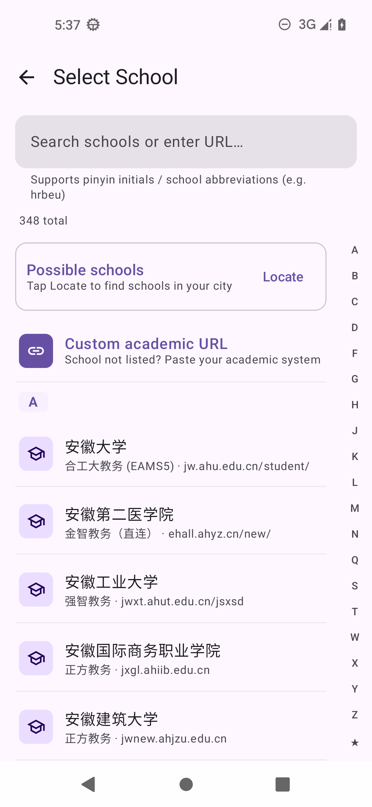
</p>

> 学校选择（演示设备此页使用英语）

学校目录会随版本更新。学校条目区分已有导入配置、待验证可尝试和待适配；待验证项需确认，待适配项不能直接导入。如果学校暂时不在目录中，也可以在搜索框输入教务系统 URL，Sleepy 会尝试根据 URL 识别协议，再打开该地址进行登录和导入。能否成功取到课表取决于学校页面、登录方式和对应解析器。

学校名称、状态、可用教务入口与来源记录见 **[学校目录与状态](docs/schools-list.md)**，支持 Ctrl+F 按全名 / 简称 / 拼音缩写检索，也用于核实教务地址和学校改名。目录条目的证据来源、协议裁定与归属闸门口径见 **[证据生成报告](docs/catalog/EVIDENCE_GENERATION_REPORT.md)** 和 **[协议映射](docs/catalog/PROTOCOL_MAPPING.md)**。

如果 URL 识别或解析仍不成功，再提交适配申请。优先提供教务 URL 和失败现象；需要进一步定位时，再按 **[适配采集教程](docs/adapt-kit/README.md)** 提供页面或网络数据。不要在 issue 中提交账号、密码、验证码或其他个人信息。也可以直接 [开一个适配申请](https://github.com/lingion/sleepy/issues/new?template=school_adaptation.yml)。

### 支持的文本格式

| 格式 | 识别特征 |
|---|---|
| **WakeUp 分享文本** | 以 `【来自WakeUp课程表】` 开头 |
| **WakeUp 分享口令** | 识别分享口令后联网从 WakeUp 服务获取课表，再生成导入预览 |
| **WakeUp JSON** | Sleepy / WakeUp 导出的 `.json` |
| **ICS 日历** | 标准 iCalendar，可从学校教务处导出 |
| **CSV 文件** | 含表头的 `.csv`，逗号分隔 |
| **HTML 表格** | `<table>` 形式，识别表头后逐行解析 |
| **纯文本** | 一行一课，竖线分列（旧的制表符格式仍可导入）；可由 AI 从课表截图生成，见上方「AI 截图转换」 |
| **sleepy-v1** | Sleepy 原生纯文本格式，带 `chk` 完整性字段和确定性记录 |

> 所有导入路径都先生成预览，确认后才写入课表。

预览会展示课程和冲突信息，可选择替换当前课表、导入为新课表、仅追加不冲突课程、合并为新课表或连冲突课程一起追加。教务导入还会让你核对课表名称、开学日期与节次时间。

<p align="left">
  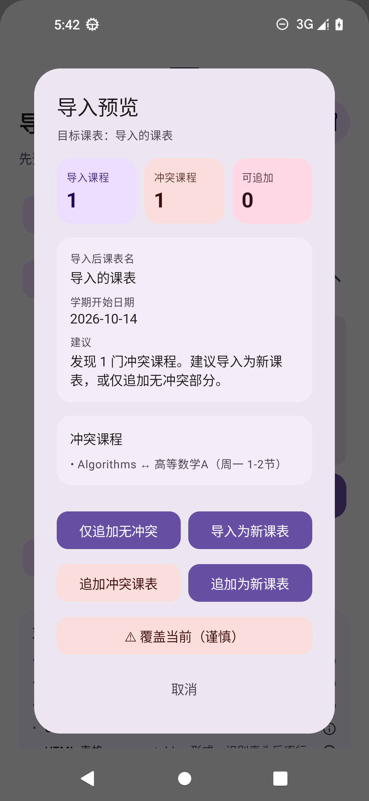
</p>

> 导入冲突预览与五种处理方式

教务流程中途退出可保留导入草稿，之后从课表管理继续；也可选择删除草稿。学校选择支持搜索、手动输入教务 URL，以及点击定位查找同城学校。

导入页提供各格式的说明与示例。「纯文本」说明中可复制 AI 截图转换提示词，交给你自行选择的识图工具，再将生成的文本粘贴回 Sleepy 预览；Sleepy 本身不会自动上传截图或内置调用 AI 服务。

<p align="left">
  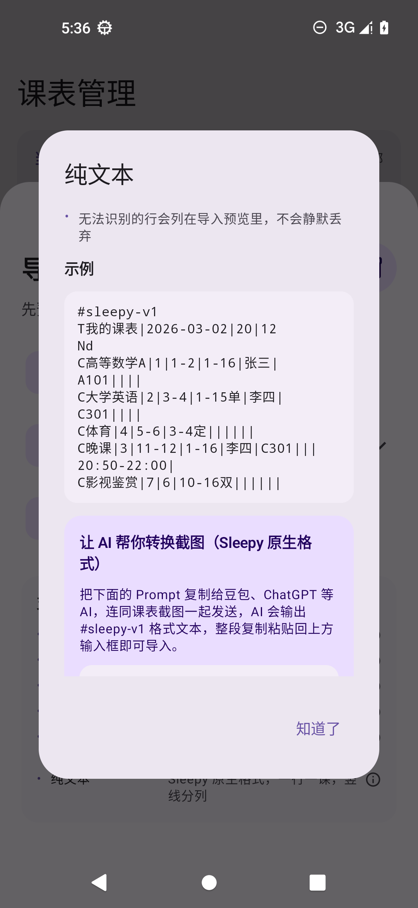
</p>

> 纯文本格式示例与外部识图提示词说明

---

## 课程编辑

<p align="left">
  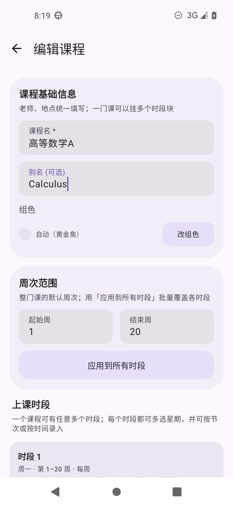
  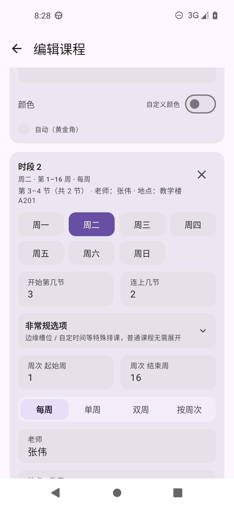
  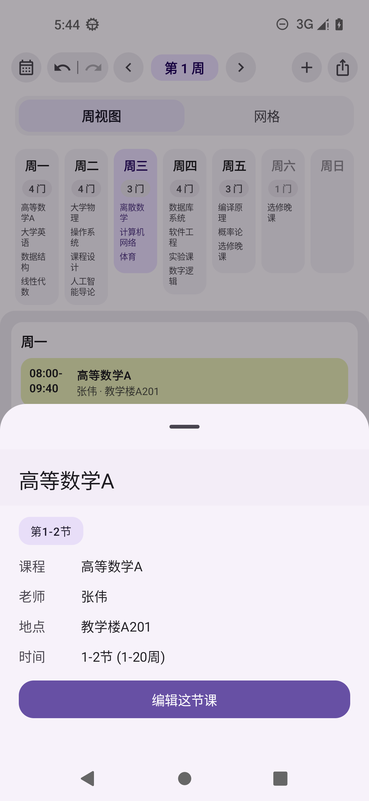
</p>

> 左：已填写别名的课程编辑页；中：第二个上课时段：可独立配置星期、节次、周次与教师；截图为未保存的虚构演示。
> 右：点击周视图课程卡片弹出详情底部弹窗

同一课程可添加多个上课时段，每个时段分别设置教师、教室、备注、星期、起止节、周次和单双周类型；可把周次设置应用到所有时段。

课程支持原名与可选别名、整组配色及每时段配色。别名仅用于显示，不改变课程身份；周视图、网格和每个小组件可分别决定是否使用别名。保存前会校验输入并提示冲突。

也可只调整或删除某一天的**单次课程**，保留其他周次的安排。网格空白处可呼出预填星期与节次的快速加课胶囊；长按课程可浮起拖动、拉伸起止节次，拖至左右边缘还能连续切换周次，确认后保存本次调整。时间与节次范围滑杆会保留原始区间的幽灵标记，方便比较修改前后的位置。

---

## 导出课表/作息表

支持多种导出格式；Android 10+ 的文件型导出保存到 `Download/Sleepy/` 后打开系统分享面板，Android 8–9 使用应用缓存文件分享。具体格式以当前版本导出页为准。

<p align="left">
  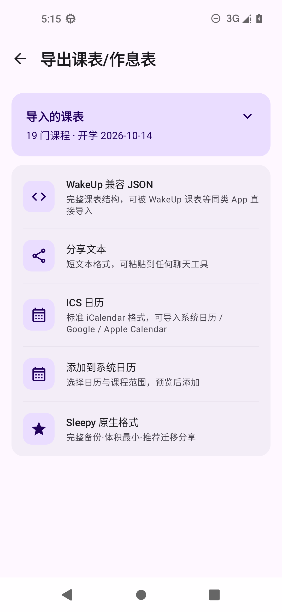
</p>

> 截图：导出页（在「我的 → 导出课表/作息表」）；此图尚未展示新增的小爱课程表入口。

导出页先选课表或作息表（上半区为全部课表，分隔线之下为全部作息表）：选择**课表**时，有四种分享/文件格式，以及小爱课程表和系统日历入口；选择**作息表**时，仅提供两种格式（JSON 与 sleepy-v1）。

课表四种导出格式：

| 格式 | 用途 | 实现 |
|---|---|---|
| **WakeUp 兼容 JSON** | 完整课表结构，可被 WakeUp 课表等同类 App 直接导入 | `ScheduleExporter.exportWakeUpJson` |
| **分享文本** | 短文本格式（URL 编码 JSON），可粘贴到任何聊天工具 | `ScheduleExporter.exportWakeUpShareText` |
| **ICS 日历** | 标准 iCalendar 格式，可导入系统日历 / Google / Apple Calendar | `ScheduleExporter.exportIcs` |
| **sleepy-v1** | Sleepy 原生纯文本格式，可再次导入或编辑 | `SleepyNativeExporter` |

文件型导出保存为 `Download/Sleepy/sleepy_<表名>_<时间戳>.{json|ics|sleepy}`，随后打开系统分享面板；分享文本直接通过分享面板发送。

旧版 WakeUp 分享文本仍可继续导入。

### 小爱课程表

选中课表后可点「小爱课程表」：Sleepy 在本地准备数据，交给小爱 App 预览，随后由用户在小爱中确认导入。小爱接收后的联网与数据处理遵循其自身规则；未安装可处理此入口的小爱 App 时会提示安装。

此入口支持 1–30 周；日期、课程周次及节次设置不合法时会提示并停止。作息节次须从 1 连续编号、按时间顺序排列且不重叠；小爱要求上午（13:00 前）1–10 节、下午（13:00–18:00 前）及晚间各 0–10 节，因此仅下午或晚间的作息表暂不支持。自定义时间课程按所选作息表吸附到节次，不能保留精确分钟。

### 添加到系统日历

导出页还可直接将课程添加到设备上的可写日历：先选择目标日历和范围（未来 7 天、未来 1 个月或本学期剩余课程），可应用本课表调课安排、设置普通日历提醒，生成预览后再确认写入。首次使用才申请日历读写权限。设备没有可写日历账户时，会自动创建本机 Sleepy 日历，无需登录云端账户。第 1 节课程闹钟提醒为实验能力，实际响铃取决于系统日历与账户。

---

<a id="桌面-widget5-类-13-变体"></a>

## 桌面 Widget（5 类 14 变体）

5 类 Widget × 14 个固定尺寸变体：Today / TwoDay / WeekList 各有常规 / 小 / 宽三档，WeekView / WeekGrid 各有常规 / 小两档。布局尺寸与各 launcher 自适应。

<table>
  <tr>
    <td width="36%" valign="top" align="center">
      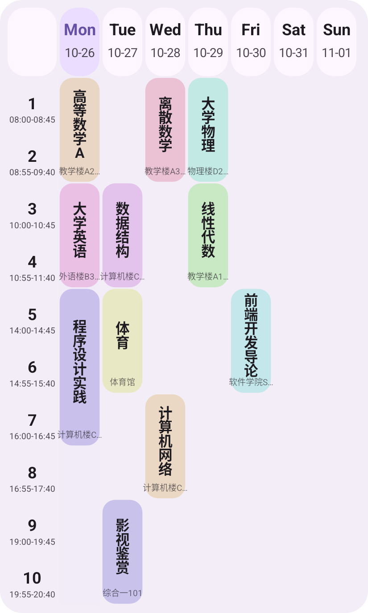
      <br>
      <sub><b>周网格小组件 (WeekGrid)</b></sub>
    </td>
    <td width="64%" valign="top" align="center">
      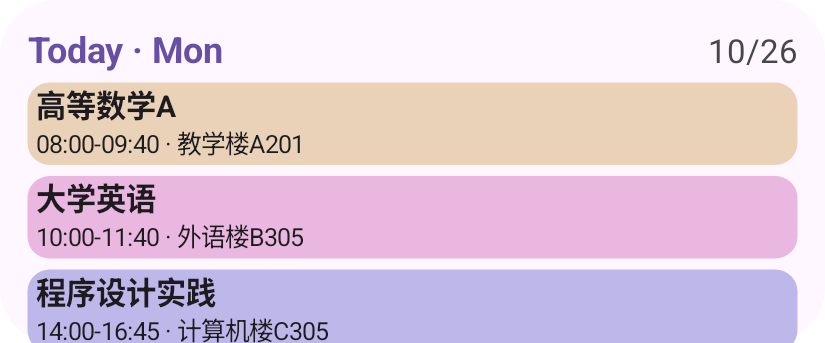
      <br>
      <sub><b>今日小组件 (Today)</b></sub>
      <br><br>
      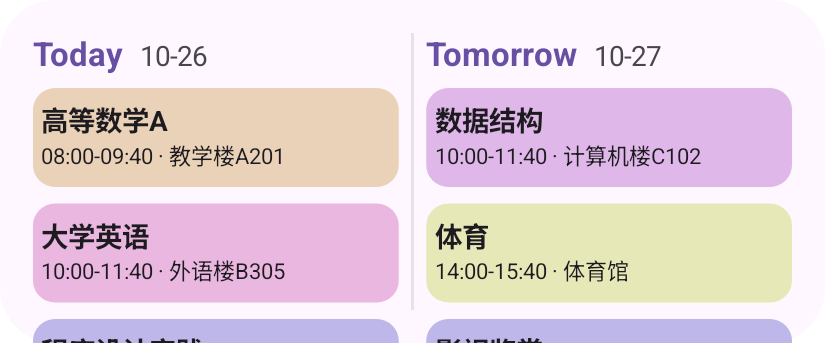
      <br>
      <sub><b>未来两天小组件 (TwoDay)</b></sub>
      <br><br>
      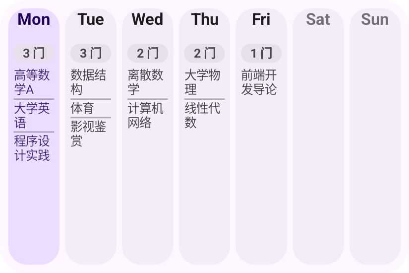
      <br>
      <sub><b>周视图小组件 (WeekView)</b></sub>
      <br><br>
      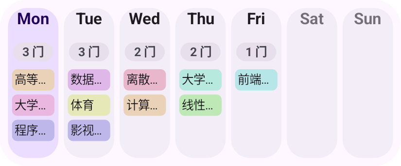
      <br>
      <sub><b>周列表小组件 (WeekList)</b></sub>
    </td>
  </tr>
</table>

| Widget | 变体 | 用途与特性 |
|---|---|---|
| **WeekGrid（周网格）** | 常规 / 小 | 时间网格 + 课程块，直观展示课程时间与地点，支持自动跳至最近有课日 |
| **Today（今日）** | 常规 / 小 / 宽 | 今日课程列表，呈现当前与后续课程节次、时间与教室 |
| **TwoDay（未来两天）** | 常规 / 小 / 宽 | 今天 + 明天（左右双栏），便于晚间提前掌握次日日程 |
| **WeekView（周视图）** | 常规 / 小 | 周视图纯主题色网格缩略，支持三日紧凑窗口 |
| **WeekList（周列表）** | 常规 / 小 / 宽 | 7 日课程统计与名称缩略，支持三日紧凑窗口 |

图片来源：基于生产渲染器直出并裁切至组件边界，透明圆角背景，采用官网统一演示课表。桌面实际尺寸和字体截断由启动器及所选变体决定。

<p align="left">
  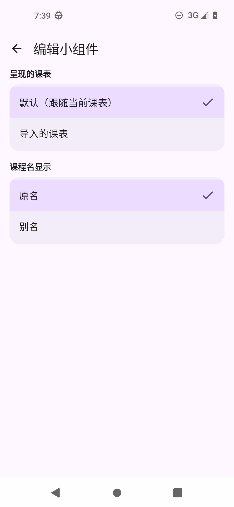
</p>

> 单个桌面小组件：课表绑定与课程名显示

逐个小组件配置：
- 在「通用设置 → 小组件管理」选择已添加的桌面小组件，可固定显示某张课表，或跟随当前课表
- 每个实例独立选择课程原名/别名；适用变体可启用实验性滚动
- WeekList 小号和 WeekView 小号支持三天窗口，选择今天在第一位还是第二位
- 「我的」提供手动刷新全部小组件入口

实现要点：
- 全部 5 类：v1.0.29 起为同步 RemoteViews + Canvas 渲染（OPPO 等深度定制 launcher 会冻结 Glance 的异步 SessionWorker，导致卡片不刷新，故整体移植）
- **v1.0.55：固定尺寸布局分档**——每个变体按自身尺寸档位选布局，不再单布局拉伸
- **v1.0.55：部分变体提供实验性滚动**（内容超出卡片高度时可滚动查看）
- **v1.0.55：上课/下课边界触发刷新**，跨过节次边界时卡片内容自动更新
- 配色与 app 主题实时同步（深色模式 + 5 主题预设）
- **三条渲染路径（主 app / WeekGrid / 截图渲染器）共享课程配色逻辑**：支持经典黄金角配色、跟随主题和自定义主色，也可为课程单独指定颜色
- 刷新机制：对全部 receiver 广播 `APPWIDGET_UPDATE`（系统级）+ WorkManager 定时刷新 + 上课/下课边界刷新

---

## 冲突课程和撤回

同一时间有多门课程时，网格视图保留两层可见内容，点击被覆盖区域可以轮换显示其他课程；三门以上的冲突不会静默丢失。叠层样式支持任意层数。

手动添加或编辑课程遇到冲突时，提示会列出星期、节次、实际重叠周次和冲突课程。确认后才保存，返回修改则不写入。

顶栏提供多步撤回与重做，用于逐步回退课表数据修改、恢复刚撤回的修改；无可用操作时隐藏对应入口。「通用设置 → 实验功能」可设置保留步数（默认 5 步，`0` 关闭，`-1` 不限步数）。历史仅保存在内存中，进程结束后清空；切换当前课表不会被当作数据修改记录。

「我的 → 外观与主题 → 课表显示」可切换叠层、折角、侧栏三种冲突样式，并调整对应的偏移或折角大小。

<p align="left">
  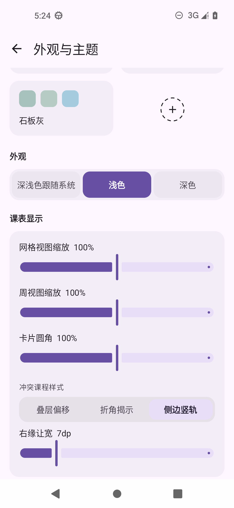
</p>

> 冲突样式设置（效果见网格视图）

---

## OPPO 流体云

**已接入 Android 16 Live Updates 通道**：`FluidCloudService` 前台服务通过 `VendorLiveCardRenderer` 构建 `NotificationCompat.ProgressStyle` 实时通知，并请求 promoted ongoing 展示。OPPO / 一加 / realme 共用 ColorOS 适配分支；仓库已有 RMX6688 / ColorOS 16 的真机行为记录，实际胶囊和卡片展示仍取决于机型、系统版本及授权，保留实验标记。

- 在「我的 → 提醒 → 课前提醒」选择「流体云」（默认使用横幅，两者互斥）；支持课程名、时间、教室或倒计时作为胶囊主显示内容，进度每 15 秒更新，上课时结束
- 提醒页提供 2 分钟测试投放和结束入口，并检查通知权限、系统实时更新授权及厂商能力状态；OPPO 家族 API 36+ 优先跳转实时更新授权页。权限允许不代表卡片已显示；旧系统或未获提升时按普通进度通知展示，通知权限关闭仍会影响可见性
- **Pantanal / Seedling SDK + UPK 专用通道尚未接入**：`app/libs/` 中的 `SeedlingSupportSDK-lite 3.0.7` AAR 未声明为 Gradle 依赖，`SeedlingCardWidgetProvider` 未实现或注册；[`oppo-fluid-cloud-upk/`](oppo-fluid-cloud-upk/) 仅为源工程骨架，仍保留 `REPLACE_WITH_OPPO_*` 占位，不能作为发布或验收证据
- 代码依据、两条通道的边界及验证范围见 [OPPO / ColorOS 接入状态](docs/vendors/oppo-coloros-fluid-cloud.md)

---

## 课程通知 & 提醒

入口在「我的」→「提醒」跳独立页面。master toggle 默认关闭，点击开启时请求通知权限——拒绝则回弹关闭，再点再问（非一次性）。

<p align="left">
  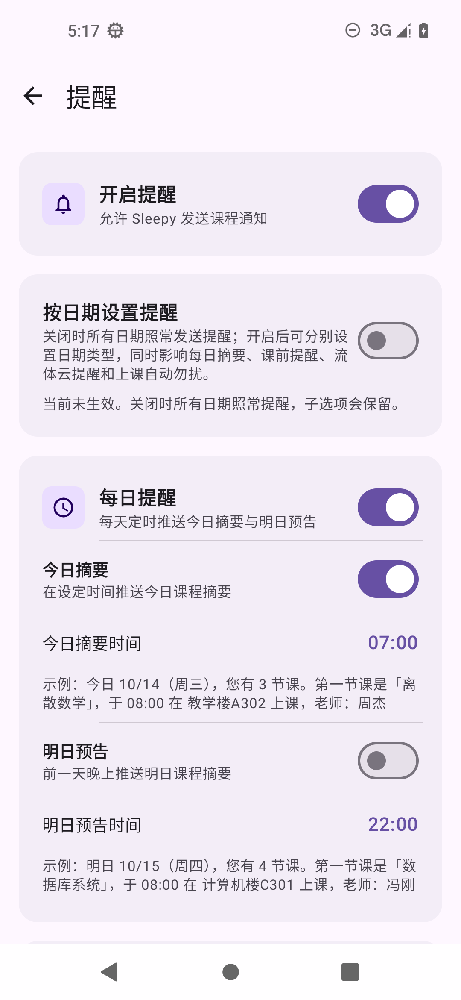
  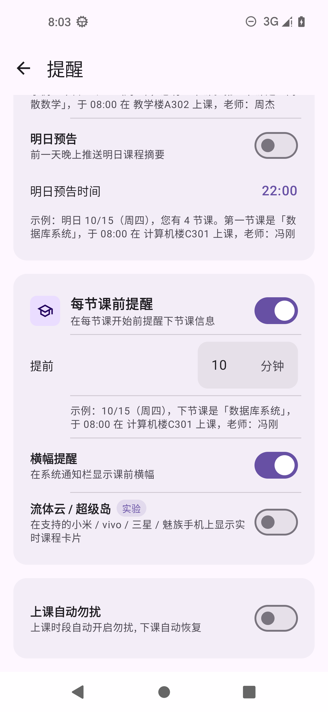
</p>

| 子功能 | 触发时机 | 内容（动态生成） |
|---|---|---|
| **今日摘要** | 每天指定时间 | `今日 15 号 您有 3 节课 第一节课 高等数学 于 08:00 在 教学楼A101 上课` |
| **明日摘要** | 单独设置每天提醒时间 | 提前查看明天的课程安排 |
| **每节课前提醒** | 每节课前 N 分钟 | `下节课 高等数学 于 08:00 在 教学楼A101 上课` |

- **分课表提醒**：在「我的 → 提醒 → 课表提醒」查看全部课表，逐表开关并立即保存；沿用已有设置，关闭总开关时仍可预先配置，开启总开关后生效。编辑课表页面不再放置提醒开关。
- 今日、明日和课前提醒提供当前课表的动态内容预览
- 日期规则可分别配置法定节假日、调休日、补班日和普通周末
- 课前提醒在通知横幅和实验性流体云之间二选一，切回横幅会停止流体云服务；流体云支持主显示字段选择、测试与结束入口，以及通知/精确闹钟/电池等可靠性状态检查
- **上课自动勿扰**：授予系统勿扰访问权限后，上课期间开启勿扰，下课恢复
- 课前分钟数**自由输入**（1–999，胶囊型输入框，非硬编码选项）
- 提醒内容**动态查询当天课表**，无课则推送「今日 X 号，今天没有课程」
- 通知通过 `AlarmManager` 精确/非精确双路降级，Android 12+ 兼容
- `BootReceiver` 重注册（开机/更新后自动恢复）
- 总开关状态本地持久化（`AppPrefs`，SharedPreferences）
- 提醒总开关关闭时不会主动请求通知权限；开启提醒时由提醒页面引导授权

---

调课按源日期的教学周、单双周和起止周筛选课程，再安排到目标日期；源日移出、目标日原课被替换。跨周和同星期跨周调课适用于课表、今日页、小组件、提醒、勿扰和日历导出。

## 关于

入口在「我的」→「关于」跳独立页面，集中展示版本、作者、开源信息。

<p align="left">
  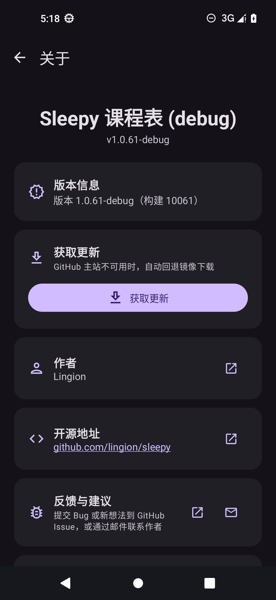
</p>

| 区块 | 内容 |
|---|---|
| **版本信息** | 版本号 + 构建号（`BuildConfig.VERSION_NAME` / `BuildConfig.VERSION_CODE`） |
| **作者** | Lingion，点击跳 GitHub 主页 |
| **开源地址** | github.com/lingion/sleepy，点击可跳转 |
| **开源声明** | GPL-3.0 协议说明、源码与依赖声明、调研引用及跨校与单校致谢 |

关于页提供手动更新检查及启动自动检查开关；自动检查默认开启，可关闭。检查会访问更新服务。检查到新版本时先展示完整更新说明，确认后才下载；下载过程可取消。

---

## 深色模式、自定义主题与课表外观

多套预设 + 跟随系统，每套含 Light/Dark 配色方案，在「我的」→「外观与主题」（`AppearanceScreen`）切换。

<p align="left">
  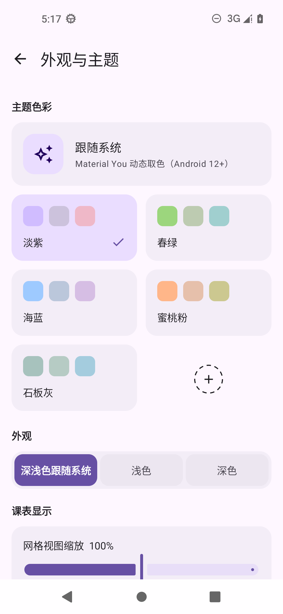
  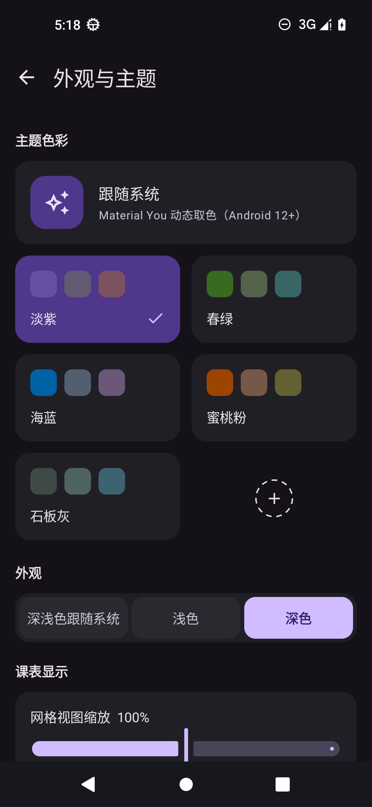
</p>

| 主题 | 风格 |
|---|---|
| 默认淡紫 | Material 3 紫色调 |
| 春绿 | 抹茶植物 |
| 海蓝 | 沉静冷调 |
| 蜜桃粉 | 暖橙 |
| 石板灰 | 中性冷淡 |
| 跟随系统 | 使用系统主题色 |

主题色与深浅模式独立设置：可跟随系统，也可强制浅色或深色。点击新建主题可随机生成、从主色派生整套配色，或逐一设置主交互色、次级强调、第三强调和表面中性色；编辑器提供颜色选择和实时预览，支持保存、重命名及删除。主题变更同步刷新桌面小组件。

外观页可独立选择经典或**液态玻璃**界面风格，覆盖按钮、开关、滑杆、分段选择与弹窗；底栏形态、明暗模式和主题颜色分别设置。液态玻璃提供背景折射、模糊和拖动透镜效果；运行时着色器效果需要 Android 13+，不支持时使用兼容渲染。页面切换、弹层和课表交互使用 Material 3 Expressive 动效。

课程配色可选经典黄金角、跟随主题或自定义主色，支持预览与重新配色，也可开启无色模式。

<p align="left">
  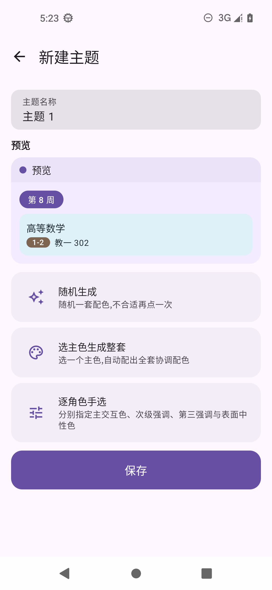
</p>

> 新建自定义主题与实时预览

外观页还可调整周视图/网格的课程块缩放与圆角、冲突显示样式，以及节次表头的传统/三行布局、文字显示和悬挂偏移。

<p align="left">
  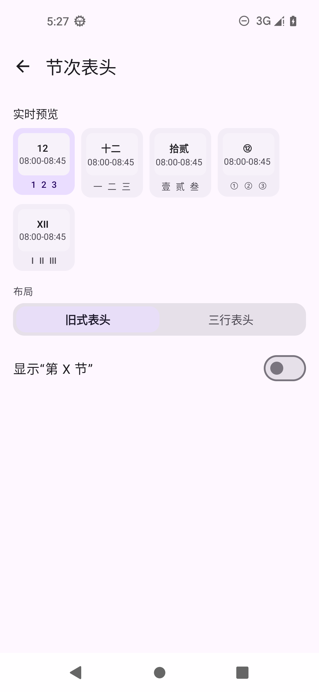
</p>

> 节次表头样式及布局设置

---

## 课表管理与通用设置

<p align="left">
  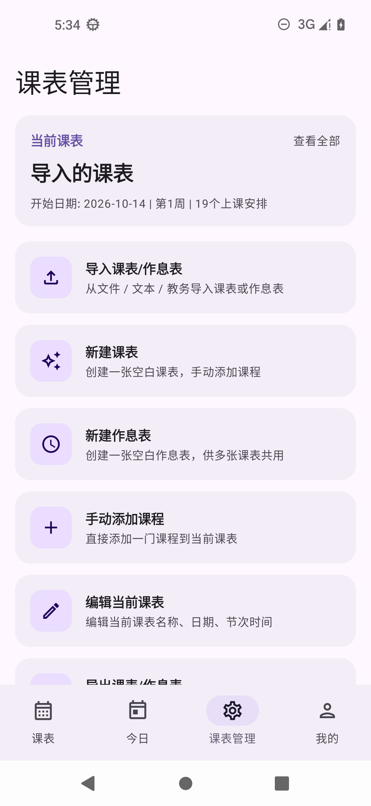
</p>

课表管理集中提供当前课表摘要、导入及草稿、新建课表、新建作息表、手动添加课程、编辑当前课表与导出入口。

「我的 → 通用设置」包含以下配置：

<p align="left">
  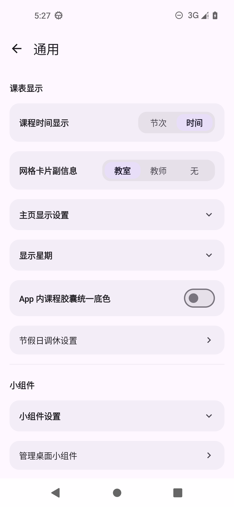
  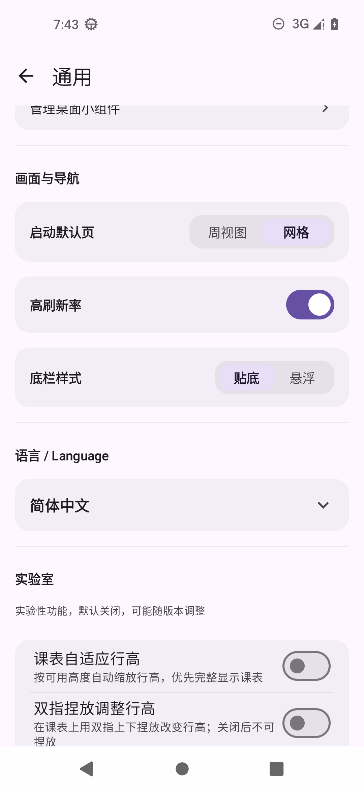
</p>

> 通用设置：课表显示与小组件入口

| 分类 | 可配置内容 |
|---|---|
| 课程信息 | 显示节次或具体时间，网格副信息显示教室、教师或隐藏，周视图/网格分别使用别名 |
| 周视图布局 | 双列展示、按天分列或均衡分列、隐藏空白日期 |
| 显示范围 | 选择显示星期、日期及视图切换器，课程无色模式 |
| 小组件全局设置 | 无色模式、分隔线、无课时查找最近有课日、小组件管理入口 |
| 导航与语言 | 启动默认视图、高刷新率、停靠/悬浮底栏、简中/繁中/英语/日语/西班牙语 |
| 实验功能 | 网格自适应高度、双指缩放、自动隐藏晚间节次、竖排标点、分隔线和大课间留白 |

### 节假日与调休

<p align="left">
  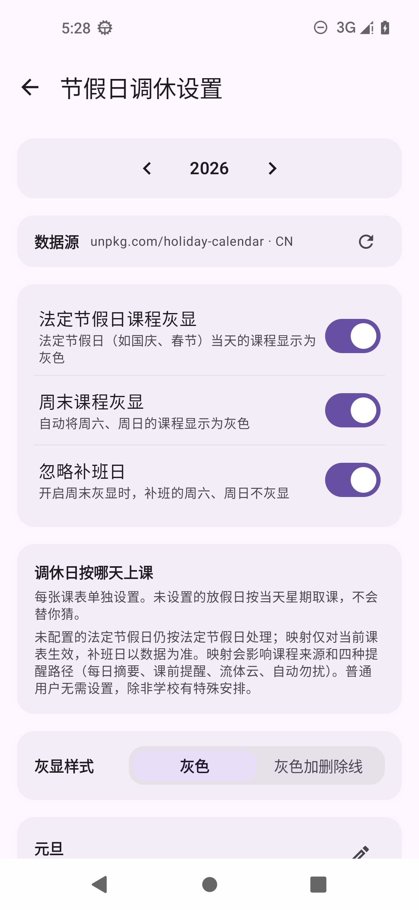
</p>

> 节假日灰显和调休设置

进入「通用设置 → 节假日调休设置」可切换年份、刷新中国节假日数据，设置法定节假日和周末课程灰显，以及是否排除补班日。支持添加、编辑、删除或恢复自定义日期段。

学校调休可按当前课表设置日期映射，指定调休日采用哪一天的课程；不同课表分别保存。它会影响课程来源及每日摘要、课前提醒、流体云和自动勿扰的日期判断。节假日灰显与提醒日期规则是不同设置，可分别调整。

### 全量备份与换机迁移

<p align="left">
  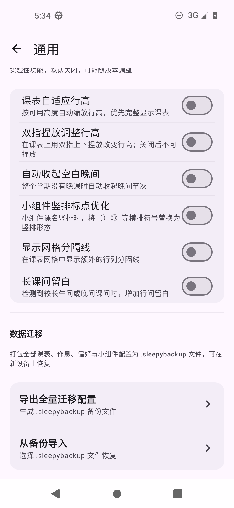
</p>

> 实验设置与全量数据迁移入口

「我的 → 备份恢复」可将全部课表、作息表、偏好和小组件配置打包为 `.sleepybackup`。恢复前可选**合并导入**（保留本机课表并追加，备份中的同名偏好会覆盖本机值）或**覆盖导入**（替换备份包含的课表与设置模块）。换机备份与单张课表的 JSON/ICS/文本导出用途不同。

也可以自愿配置 WebDAV，将完整备份手动上传到自己的 HTTPS 服务器，或查看服务器目录中的备份并选择恢复。连接测试会验证服务器，并在目录尚不存在时尝试创建目录；上传会生成带时间戳的新文件，不覆盖旧备份，也没有后台自动同步或远端删除功能。恢复仍须确认合并或覆盖。

备份包含课表与课程内容、作息表、偏好和自定义主题、小组件配置及导入草稿；它是普通 ZIP 文件，文件本身没有加密。服务器管理员或有目录访问权限的人可能读取内容，请只上传到可信服务器。WebDAV 地址仅接受 HTTPS；用户名和目录保存在本机应用私有设置中，密码由 Android Keystore 加密保存。WebDAV 连接设置和密码不进入 `.sleepybackup` 或 Android 系统备份；移除本机配置不会删除服务器上的文件。

---

## 技术栈

| 类别 | 技术与版本 |
|---|---|
| 语言 | Kotlin 2.4.21；Java / Kotlin JVM 目标版本为 17 |
| 界面 | Jetpack Compose（BOM 2026.09.00）+ Material 3 1.5.0-beta02，使用 Expressive 组件与动效 |
| 液态玻璃与配色 | 本地 `:kyant-backdrop` 模块（基于 AndroidLiquidGlass 2.0.0 并含本地修改）；Kyant Shapes 1.2.1；Material Color Utilities 1.7.0 |
| 导航 | Navigation 3 1.1.7 + NavigationEvent 1.2.0；Lifecycle ViewModel Navigation 3 2.11.0 |
| 数据存储 | Room 2.8.5；通过 KSP 2.3.12 生成代码 |
| 偏好设置 | SharedPreferences（`AppPrefs`）；DataStore Preferences 1.3.0 已声明，尚未使用 |
| 协程 | kotlinx-coroutines 1.11.0 |
| 序列化 | kotlinx-serialization-json 1.12.0 |
| 网络传输 | OkHttp 5.5.1（WebDAV 备份与恢复） |
| HTML 解析 | jsoup 1.23.2 |
| 桌面小组件 | RemoteViews + Canvas，同步渲染 |
| 后台任务 | WorkManager 2.12.0 |
| 图片加载 | Coil Compose 2.7.0（已声明，尚未使用） |
| 启动页 | Core Splash Screen 1.2.0 |
| 本地调试控制台 | NanoHTTPD 2.3.1，监听 `127.0.0.1:3737` |
| Android 基础库 | AndroidX Core 1.19.1；Activity Compose 1.13.0；Lifecycle 2.8.7 |
| 构建 | JDK 25 + AGP 9.5.1 + Gradle 9.8.2，使用 Kotlin DSL；应用使用 AGP 内置 Kotlin 支持 |
| Android SDK | `minSdk=26`；`compileSdk=37`；`targetSdk=37` |

版本以[依赖版本目录](gradle/libs.versions.toml)、[根构建配置](build.gradle.kts)、[应用构建配置](app/build.gradle.kts)和 [Gradle Wrapper 配置](gradle/wrapper/gradle-wrapper.properties)为准。

液态玻璃模块的源码基线与本地修改见[模块说明](third-party/kyant-backdrop/README.md)；该模块的[构建配置](third-party/kyant-backdrop/build.gradle.kts)还显式声明 Compose UI / Foundation 1.12.1，不能仅凭应用 BOM 推断最终解析版本。

---

## 项目结构

以下列出主要目录和代表性文件，省略其余文件；`notification/` 位于 `widget/` 目录下。

```text
sleepy/
├── .github/                                                   # GitHub 配置
│   └── workflows/                                             # CI、发布与自动化工作流
├── app/                                                       # Android 应用模块
│   ├── build.gradle.kts                                       # 应用构建、SDK 与依赖配置
│   ├── libs/                                                  # Seedling AAR（未声明依赖）
│   ├── schemas/                                               # Room 数据库版本快照
│   └── src/
│       ├── main/
│       │   ├── AndroidManifest.xml                            # 组件与权限声明
│       │   ├── assets/                                        # 学校目录、城市索引等内置数据
│       │   ├── java/com/lingion/sleepy/
│       │   │   ├── MainActivity.kt                            # 主界面入口
│       │   │   ├── SleepyApp.kt                               # Application 初始化
│       │   │   ├── console/                                   # 本地 HTTP 调试控制台、认证与语义操作
│       │   │   ├── data/
│       │   │   │   ├── AppDatabase.kt                         # Room 数据库
│       │   │   │   ├── Migrations.kt                          # 数据库版本迁移
│       │   │   │   ├── CustomThemeStore.kt                    # 自定义主题存储
│       │   │   │   ├── calendar/                              # 系统日历导入与本机日历
│       │   │   │   ├── backup/                                # 用户手动触发的 WebDAV 备份传输与本地凭据
│       │   │   │   ├── dao/                                   # 课程、课表、作息表等数据访问
│       │   │   │   ├── diff/                                  # 课表记录差异比较
│       │   │   │   ├── entity/                                # Room 实体与节次配置
│       │   │   │   ├── jw/                                    # 教务协议、解析器、学校检索与导入状态
│       │   │   │   ├── migration/                             # 全量备份、恢复与偏好迁移
│       │   │   │   ├── parser/                                # 课表格式解析与导出
│       │   │   │   ├── repository/                            # 课表数据与导入草稿仓库
│       │   │   │   └── undo/                                  # 撤回与重做
│       │   │   ├── ui/
│       │   │   │   ├── component/                             # 课表、节次编辑器等共享 Compose 组件
│       │   │   │   │   └── liquidglass/                        # 液态玻璃底栏、着色器、几何与手势
│       │   │   │   ├── nav/                                   # 路由、导航栈与页面转场
│       │   │   │   ├── screen/
│       │   │   │   │   ├── edit/                              # 课程编辑
│       │   │   │   │   ├── imports/                           # 教务登录、学校选择与导入
│       │   │   │   │   ├── manage/                            # 课表管理
│       │   │   │   │   ├── mine/                              # 设置、主题、作息表、导出与关于
│       │   │   │   │   ├── schedule/                          # 周视图与网格视图
│       │   │   │   │   ├── today/                             # 今日课程与每日议程
│       │   │   │   │   └── widget/                            # 小组件图库、管理与编辑页面
│       │   │   │   └── theme/                                 # 主题、预设与自定义配色生成
│       │   │   ├── util/                                      # 偏好、日期、配色、冲突布局与更新等工具
│       │   │   └── widget/                                    # 小组件提供器、渲染、配置与刷新
│       │   │       └── notification/                          # 提醒、勿扰与实时通知（以下列出主要文件）
│       │   │           ├── CourseNotificationScheduler.kt     # 课程提醒与摘要调度
│       │   │           ├── ClassDndScheduler.kt               # 上课自动勿扰
│       │   │           ├── DailyScheduleSummary.kt            # 每日课程摘要
│       │   │           ├── ReminderRescheduler.kt             # 提醒重新调度
│       │   │           ├── FluidCloudService.kt               # 流体云前台服务
│       │   │           └── VendorLiveNotificationAdapters.kt  # 厂商实时通知适配器集合
│       │   └── res/                                           # 图标、RemoteViews 布局、主题、多语言与 XML 配置
│       ├── debug/                                             # 调试包组件、资源与渲染辅助代码
│       ├── test/                                              # JVM 单元测试、fixtures 与像素基准
│       └── androidTest/                                       # 设备端测试与渲染测试
├── docs/                                                      # 设计、适配验证与版本说明等文档
│   ├── adapt-kit/                                             # 学校适配采集教程
│   ├── architecture/                                          # 架构说明
│   ├── catalog/                                               # 学校目录来源与协议映射
│   ├── screenshots/                                           # README 截图
│   ├── sop/                                                   # 操作流程索引
│   └── logo.png                                               # README 顶部标志
├── assets/                                                    # 原始标志图片
├── oppo-fluid-cloud-upk/                                      # Pantanal/Seedling UPK 骨架（专用通道未接入）
├── artifacts/                                                 # 已归档构建产物
├── scripts/                                                   # 学校目录生成、校验与版本维护脚本
├── third-party/
│   └── kyant-backdrop/                                         # AndroidLiquidGlass 本地源码依赖与补丁
├── tools/                                                     # 小组件预览、设备验证与教务采集工具
│   └── sleepy-collector/                                      # Go 教务适配采集器
├── tasks/                                                     # 计划与待办记录
├── gradle/
│   ├── gradle-daemon-jvm.properties                           # 构建 JVM 固定为 JDK 25
│   ├── libs.versions.toml                                     # 依赖版本目录
│   └── wrapper/                                               # Gradle Wrapper 配置与 JAR
├── build.gradle.kts                                           # 根构建插件配置
├── settings.gradle.kts                                        # 仓库与模块配置
├── gradle.properties                                          # Gradle 与 Kotlin 构建选项
├── gradlew                                                    # Unix Gradle Wrapper 入口
├── gradlew.bat                                                # Windows Gradle Wrapper 入口
└── LICENSE                                                    # GPL-3.0
```

---

## 构建 & 安装

### 前置

构建使用 **JDK 25 + 仓库自带的 Gradle 9.8.2 Wrapper + Android Gradle Plugin（AGP）9.5.1**。Android Studio 需支持 AGP 9.5，版本兼容要求见 [AGP 9.5 官方说明](https://developer.android.com/build/releases/agp-9-5-0-release-notes)。本地编译、单元测试和 CI 统一使用 JDK 25；Java / Kotlin 编译目标仍为 17，最低 Android 版本仍为 Android 8.0（API 26）。

完整的 Temurin JDK 版本统一记录在 [`.tool-versions`](.tool-versions)，CI、Nightly 和 Release 都从该文件安装。先安装文件指定的 JDK，将 `JAVA_HOME` 指向其根目录，并将其 `bin` 加入 `PATH`；Android Studio 的 Gradle JDK 也选择同一版本。使用 asdf 的开发者可通过 Java 插件执行 `asdf install`。

[`gradle/gradle-daemon-jvm.properties`](gradle/gradle-daemon-jvm.properties) 将 Gradle Daemon 限定为 Java 25，并在 Linux x64/ARM64、macOS Intel/Apple Silicon 和 Windows x64 缺少 JDK 25 时下载 `.tool-versions` 对应版本。Gradle 的主版本条件不会强制升级本机已有 JDK 的补丁版本，本地对齐仍以 `.tool-versions` 为准。通过 `./gradlew --version` 检查 `Daemon JVM`，不要只看 `java -version`。Renovate 每日检查 Java 25 正式版补丁，并在同一 PR 中更新版本文件和下载地址；CI 校验一致性，详情见 [JDK 自动更新](docs/ci-automation.md#23-jdk-补丁更新-renovatejson)。

```bash
java -version           # JDK 25
./gradlew --version     # Daemon JVM: Java 25

sdkmanager "platforms;android-37.0" "build-tools;36.0.0"
```

项目配置 `compileSdk=37`、`targetSdk=37`；平台安装包标识为 `platforms;android-37.0`。项目未显式固定 `buildToolsVersion`，AGP 9.5 默认使用 Build Tools 36.0.0。

若遇到 `SDK XML versions up to 3` / `SDK XML file of version 4` 警告，先确认通过本仓库的 `gradlew` / `gradlew.bat` 构建，再在 Android Studio 的 SDK Manager → SDK Tools 中更新 **Android SDK Command-line Tools (latest)**。IDE、`ANDROID_HOME` 和 `local.properties` 中的 `sdk.dir` 应指向同一个 SDK；命令行使用该 SDK 的 `cmdline-tools/latest/bin/sdkmanager`（Windows 为 `sdkmanager.bat`），避免 `PATH` 命中旧的 `tools/bin/sdkmanager`。参见 [sdkmanager 官方文档](https://developer.android.com/tools/sdkmanager)。

### 编译

Linux / macOS：

```bash
git clone https://github.com/lingion/sleepy.git
cd sleepy

# Debug（x86_64 模拟器 / arm64 真机）
./gradlew assembleDebug
```

Windows 原生环境（PowerShell / CMD，无需 WSL 或 Git Bash）：

1. 安装 `.tool-versions` 指定的 Temurin JDK 25，将 `JAVA_HOME` 指向 JDK 根目录（不是 `bin`），并将该 JDK 的 `bin` 目录加入 `PATH`。
2. 安装 Android SDK Platform 37 和所需的 Build Tools（可通过 Android Studio 的 SDK Manager 安装）。将 `ANDROID_HOME` 指向 SDK 根目录，或在项目根目录的 `local.properties` 中配置 `sdk.dir=C:/Users/your-name/AppData/Local/Android/Sdk`（使用正斜杠，并替换为实际路径；此文件已被 Git 忽略）。
3. 在项目根目录运行：

```powershell
java -version
.\gradlew.bat --version
.\gradlew.bat assembleDebug
# 可选：运行单元测试或清理构建产物
.\gradlew.bat testDebugUnitTest
.\gradlew.bat clean
```

Wrapper 会按 `gradle/wrapper/gradle-wrapper.properties` 下载指定版本的 Gradle，无需另行安装 Gradle；首次构建需要联网下载 Gradle 和依赖。Debug APK 输出到 `app/build/outputs/apk/debug/`。

> 不想本地编译，可以使用 [Debug APK Build](.github/workflows/debug-apk.yml)。向 `main` 提交非草稿 PR 后会自动生成 debug 包；fork 启用 Actions 后，分支推送也会自动构建。手动运行支持指定分支、标签或完整 SHA，以及单独的 `armeabi-v7a`（V7A）等架构。进入对应 Actions 运行页面，在构建摘要中选择架构下载，需登录 GitHub，产物保留 7 天。外部 PR、fork 和显式指定源码的手动构建使用临时签名，跨次构建不保证覆盖安装。完整操作见 [docs/ci-automation.md](docs/ci-automation.md)。[Nightly Main Check](.github/workflows/nightly.yml) 仍提供 main 的定时检查与手动检查。

### 安装

```bash
adb install app/build/outputs/apk/debug/app-arm64-v8a-debug.apk
# 或 x86_64 模拟器
adb install app/build/outputs/apk/debug/app-x86_64-debug.apk
```

> ABI 分包：arm64-v8a（真机主流）、armeabi-v7a（32 位备机）、x86_64（模拟器）。手动安装时请选择设备对应的 APK，也可使用 universal 包。

---

调试构建使用 `com.lingion.sleepy.debug`，与正式包分开保存数据；发布页还提供 universal APK 和校验和。

CI 在面向 `main` 的 PR 上运行提交格式检查、学校目录校验、Go 采集工具检查、WebView 抓取脚本契约检查、Android 单元测试与 Room schema 检查、Android lint 和 Release APK 构建；推送 `v*.*.*` 标签触发发布。CI 与 Release 当前都不支持手动 dispatch，手动构建使用独立的 Debug APK Build 工作流。配置见 [CI](.github/workflows/ci.yml) 和 [Release](.github/workflows/release.yml)。

## 社区

Bug 反馈和新学校适配请提交到 [Issues](https://github.com/lingion/sleepy/issues)；想聊天、提建议、第一时间了解新版本，可以加入 QQ 交流群：

**QQ 群：`1063407652`**（在 QQ 中搜索群号 → 申请加入）

不方便加群也没关系，[Discussions](https://github.com/lingion/sleepy/discussions) 里同样会认真回复。

## 文档

- **[官网](https://sleepy.is-my.app)** — 项目主页：功能介绍、学校名录、下载中心、常见问答
- **[在线体验](https://sleepy.is-my.app/preview)** — Web 版课表，浏览器打开即用，无需安装；支持多格式导入（WakeUp 分享文本 / ICS / CSV / Excel），数据仅存本地
- **[iOS 版仓库](https://github.com/lingion/sleepy-ios)** — Sleepy 课程表 iOS 移植版，SwiftUI + WidgetKit，iOS 16.0 起，与 Android 版功能对齐
- **[Wiki](https://github.com/lingion/sleepy/wiki)** — 各页面说明、导入/导出格式、小组件类型、提醒实现、架构与代码地图，可通过侧栏导航
- **[使用指南](https://blog.qdp.qzz.io/docs/sleepy/overview)** — 涵盖安装、导入、小组件、主题和故障排查的分步说明
- **[技术解析](https://blog.qdp.qzz.io/sleepy-material-you-schedule)** — 课表解析引擎、黄金角 HSL 配色、金智教务协议分析与小组件渲染流程

---

## 许可证

[GPL-3.0](LICENSE)

Sleepy 自有代码使用 GPL-3.0 发布；第三方内容保留各自的许可与署名。完整的源码移植、依赖、数据、设计资料、参考仓库和贡献者见 [引用来源与致谢](ACKNOWLEDGEMENTS.md)，应用内「我的 → 关于 → 开源声明」通过链接打开[官网许可与致谢](https://sleepy.is-my.app/licenses/)，保留完整条目及许可原文。

本项目的液态玻璃源码模块基于 [SleepDown课程表](https://github.com/xiaomanjun233/SleepDown-Schedule) 修改，原作者为 **xiaomanjun233**。Sleepy 由本项目维护，修改包括 Android 构建接线、Compose 版本适配及 FLClash 底栏集成。SleepDown 自有内容采用非商业、源码可见许可 1.1，Kyant 原始代码保留 Apache-2.0；FLClash 移植保留 GPL-3.0，Flutter 超椭圆移植保留 BSD-3-Clause。[许可原文与来源范围](ACKNOWLEDGEMENTS.md#源码来源声明)随仓库和应用保留。

---

<p align="center">
  <sub>构建无壳，自由自在。</sub>
</p>
