<p align="center">
  
</p>

<h1 align="center">Sleepy · Lightweight Timetable</h1>

<p align="center">
  A clean, Material You Android schedule/timetable app built with Kotlin + Jetpack Compose.<br>
  Multi-view · Direct JW system import · Home-screen widgets · HSV custom colors
</p>

<p align="center">
  <a href="https://github.com/lingion/sleepy/releases"></a>
  
  
  
  
  
  
  
  
</p>

<p align="center">
  <a href="README.md">中文</a> · <a href="README_EN.md">English</a> · <a href="https://github.com/lingion/sleepy/wiki">Wiki</a> · <a href="https://github.com/lingion/sleepy/releases/latest">Download APK</a> · <a href="https://github.com/lingion/sleepy/releases">All versions</a> · <a href="docs/adapt-kit/README.md">Add your university</a> · <a href="#community">💬 Community</a> · <a href="sponsor.md">Sponsor</a>
</p>

---

> **Keywords (SEO):** Android schedule app, timetable, university schedule, Jetpack Compose, Material You, Chinese university academic system import, wisedu, home screen widget, HSV color picker, open source timetable

---

## Screenshots

<p align="center">
  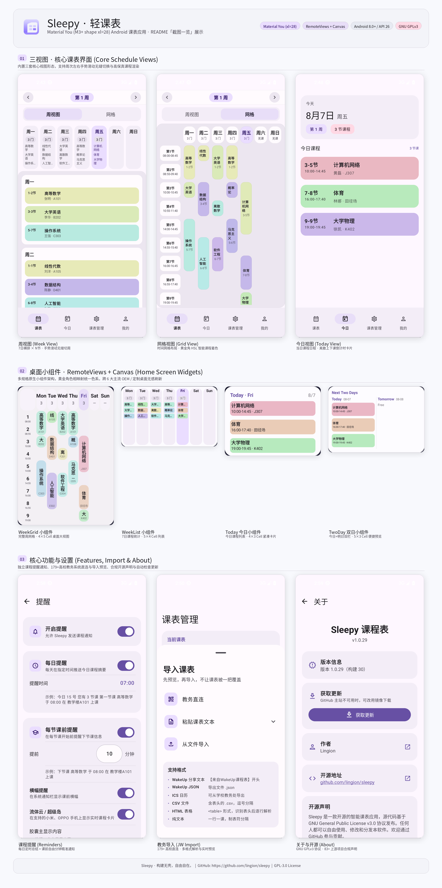
</p>

<p align="center">
  Android 8.0+ · Release <code>com.lingion.sleepy</code> · Debug <code>com.lingion.sleepy.debug</code>
</p>

---

## Overview

The school selector requests foreground location only after tapping Locate, for same-city school suggestions. Both precise and approximate access are supported; coordinates are neither saved nor sent to third parties. Fine location also supports devices that can obtain a fix only from GPS, without network location.

| Item | Value |
|---|---|
| Package | `com.lingion.sleepy` |
| Min SDK | `26` (Android 8.0) |
| Target SDK | `37` |
| ABIs | arm64-v8a / armeabi-v7a / x86_64 |
| Languages | zh-CN · zh-TW · en · ja · es |

Sleepy is an Android timetable app built around three principles: **light, fast, accurate**. Its school catalogue contains 349 entries across 33 protocol identifiers; catalogue inclusion does not mean every current school login has been tested on a device. Features include JW import, multi-format parsing, five home-screen widget types in 13 fixed-size variants, daily course notifications, dark mode, and multiple theme presets. The version and supported-school catalogue are maintained in the app's About page and on GitHub Releases. Timetables are stored locally. Network operations include JW synchronization, holiday-data refresh from `unpkg.com/holiday-calendar`, and update checks via GitHub (with the project mirror as fallback); these are not analytics services.

---

Explore: [Views](#three-views) · [Timetables](#multiple-timetables) · [Period tables](#period-configuration-manual--auto) · [Import](#jw-system-import) · [Course editing](#course-editing) · [Export and calendar](#export-timetable--period-table) · [Widgets](#home-screen-widgets-5-types-13-variants) · [Reminders](#notifications--reminders) · [Themes](#dark-mode-custom-themes-and-timetable-appearance) · [Settings and backup](#timetable-management-and-general-settings) · [Build](#build--install)

## Three Views

The timetable page switches between week and grid views in the top bar. Today is a separate bottom-navigation page.

| View | Screenshot |
|---|---|
| **Week view** (weekly overview + daily course lists) | <p align="left">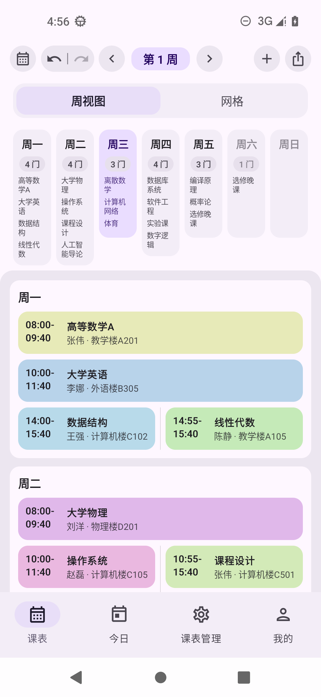</p> |
| **Grid view** (time grid · colored course blocks) | <p align="left">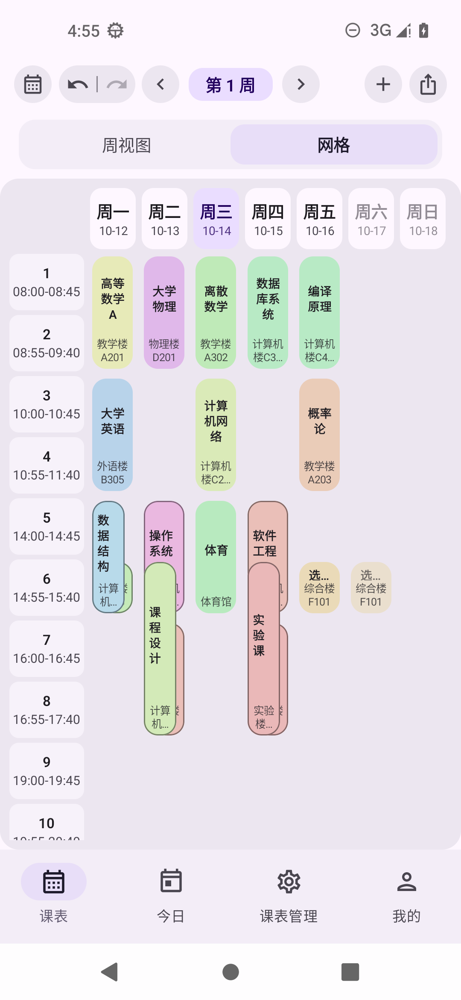</p> |
| **Today view** ("Today" tab · today's courses) | <p align="left">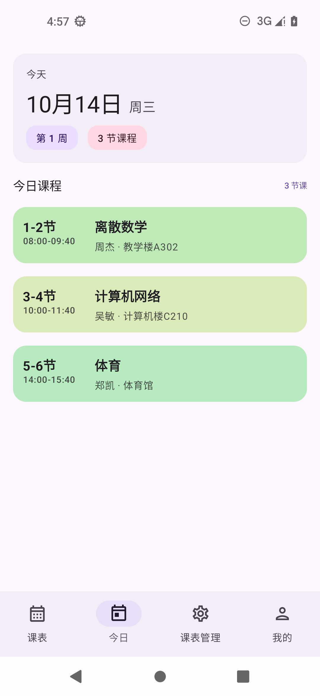</p> |

Features:

- Swipe left/right to change weeks, week number computed live
- Swipe works in both week and grid views (HorizontalPager)
- Courses filtered to the current week by week-range + odd/even + period-range
- Tap a course card for the detail bottom sheet
- Today distinguishes no classes, term not started, and term ended
- Wide screens use side navigation and a two-pane layout: the timetable stays on the left while Today, management, and Mine open on the right

---

<p align="left">
  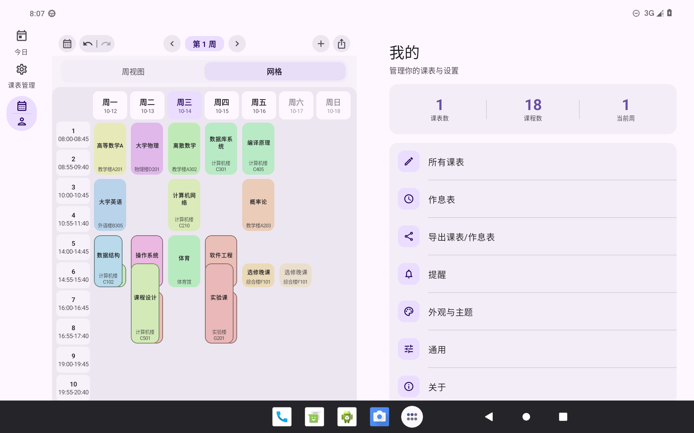
</p>

> Wide-screen layout: timetable on the left, Mine on the right

## Multiple Timetables

Manage several timetables with independent names, start dates, and maximum week counts. Each binds to a period table, which can be shared by multiple timetables.

<p align="left">
  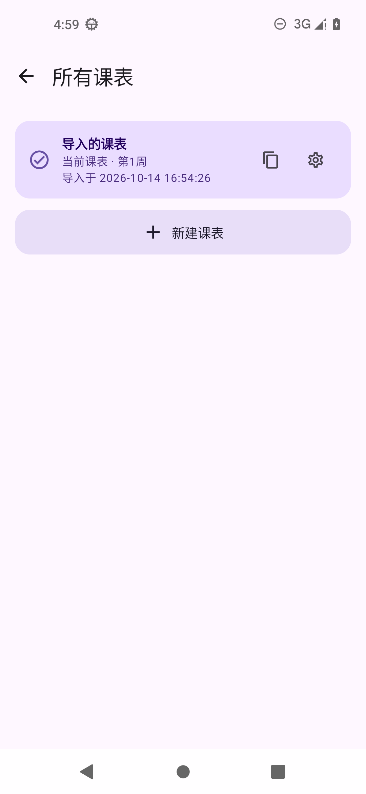
  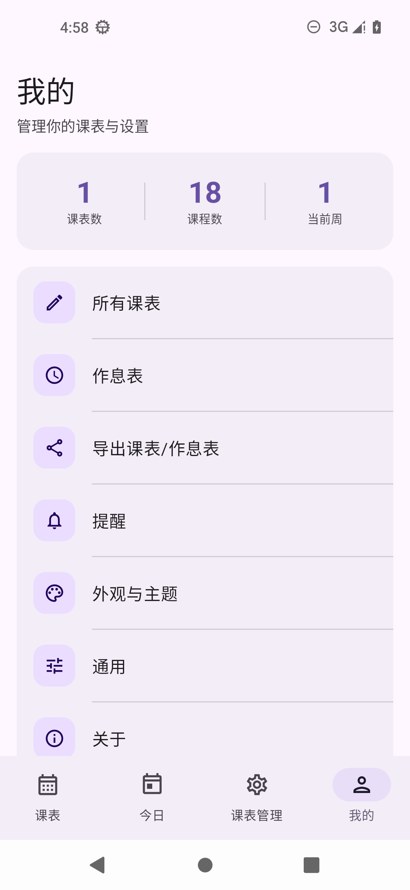
</p>

> Left: all timetables (gear icon to edit)
> Right: "Mine" page (stats + entries)

Create or edit a timetable to set its name, start date, maximum weeks, and bound period table. Mine’s statistics cards open all timetables or the course list; the latter groups each course’s locations and teaching slots.

<p align="left">
  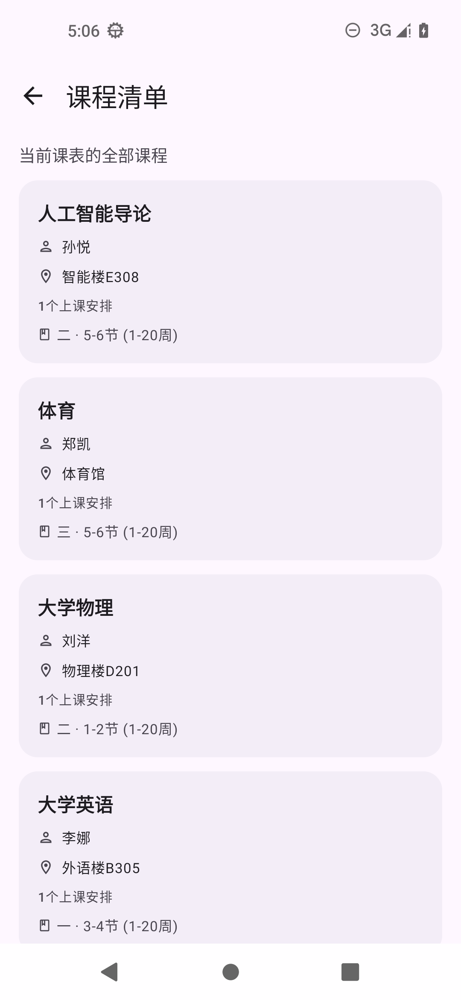
</p>

---

## Period Configuration (Manual / Auto)

<p align="left">
  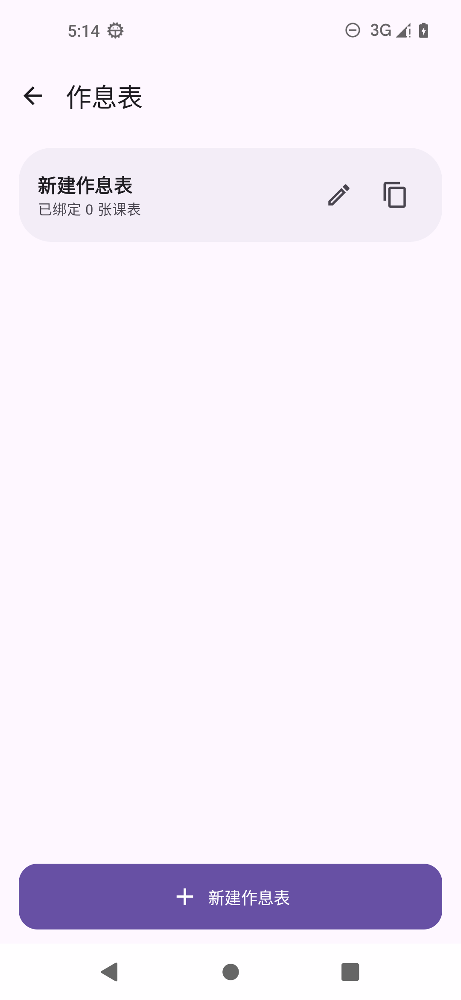
</p>

Manage independent period tables in Mine → Period tables, inspect how many timetables use one, or duplicate it before editing. Timetable management also provides a new-period-table entry. Manual mode sets each period's start and end individually. Auto mode takes period length + total periods + first bell + break templates and derives everything else.

<p align="left">
  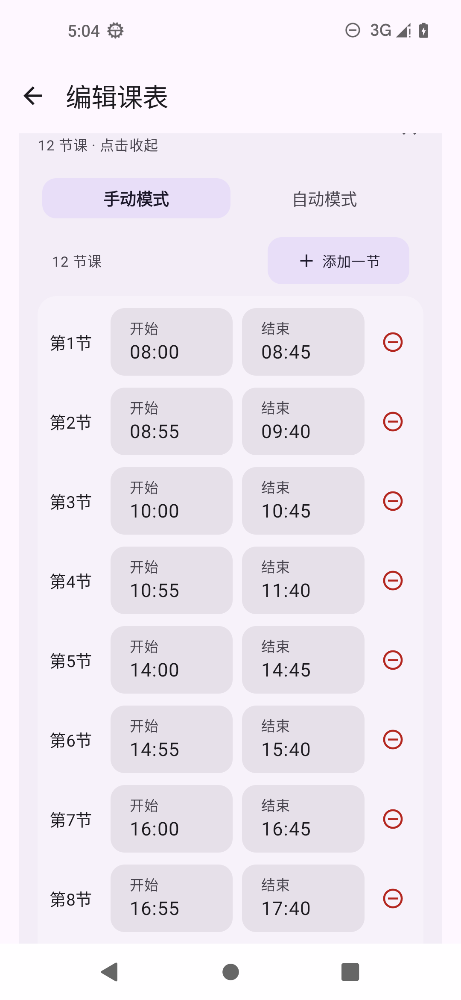
  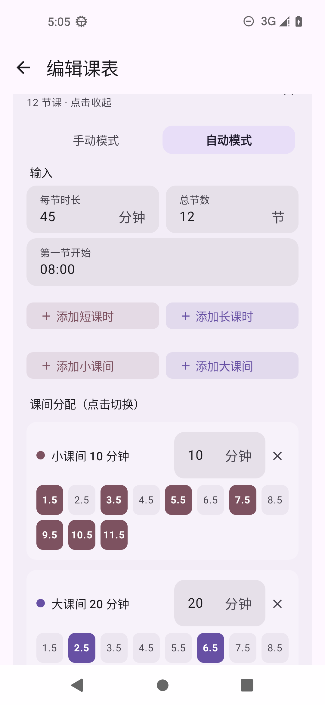
</p>

> Left: manual mode (12-period real-world HEU schedule expanded)
> Right: auto mode (period length / total / first bell / break templates / preview toggle)

Auto mode details:

- Add short/long class durations and short/long breaks, then assign them to the relevant periods or transitions
- Cross-group exclusivity (the same transition can't be both a long and a short break)
- Zero-minute gaps are valid; adjacent periods need no break between them
- Card-grid multi-select with immediate visual feedback

---

## JW System Import

Entry: bottom bar "Timetables" → "Import". Import paths preview first and only write after confirmation; they do not silently overwrite an existing timetable.

<p align="left">
  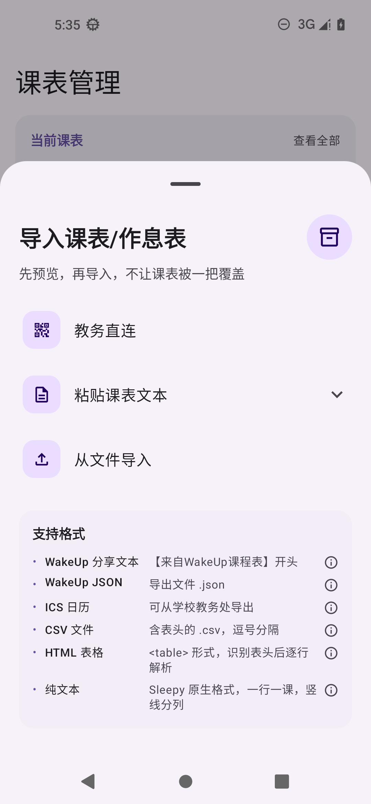
</p>

| Entry | Flow |
|---|---|
| **Direct JW import** | Pick a listed university, or enter a JW URL in the search field → WebView login → automatic fetch → preview → import |
| **Paste text** | Paste any format → auto-detect → preview → import |
| **From file** | Pick `.json` / `.ics` / `.csv` / `.html` → preview → import |

### JW Protocol Examples

The protocol catalogue grows with school integrations. The table below shows protocol families and representative variants in the code; it is not a replacement for the current in-app school catalogue:

| Protocol | Notes |
|---|---|
| `wisedu` | Wisedu JW (JSON API direct; e.g. Harbin Engineering University) |
| `qz` / `qz_old` / `qz_crazy` / `qz_br` / `qz_with_node` | Qiangzhi JW (5 variants) |
| `zf` / `zf_1` / `zf_new` | Zhengfang JW (3 variants) |
| `urp` / `urp_new` | URP JW (2 variants) |
| `cf` | Qingguo JW |
| `classic_eams` | Classic Wisedu EAMS (UESTC, SUFE, Hunan Normal, NUAA, etc.) |
| `eams5` | supwisdom EAMS5 (HFUT, Anhui Univ., CUMT-Beijing) |
| `whut` | Wuhan University of Technology (Wisedu variant) |
| `cqu` | Chongqing University unified portal |
| `seu` | Southeast University |
| `zju` | Zhejiang University |
| `ustc` | University of Science and Technology of China |
| `scu` | Sichuan University |
| `neu` | Northeastern University |
| `hnust` | Hunan University of Science and Technology JW |
| `hniu` | Hunan Information Polytechnic JW |
| `pku` | Peking University |
| `bnuz` | BNU Zhuhai |
| `chaoxing` | ChaoXing general academic affairs (Jilin Business and Technology College personal timetable) |

### School Catalogue and Custom URLs

<p align="left">
  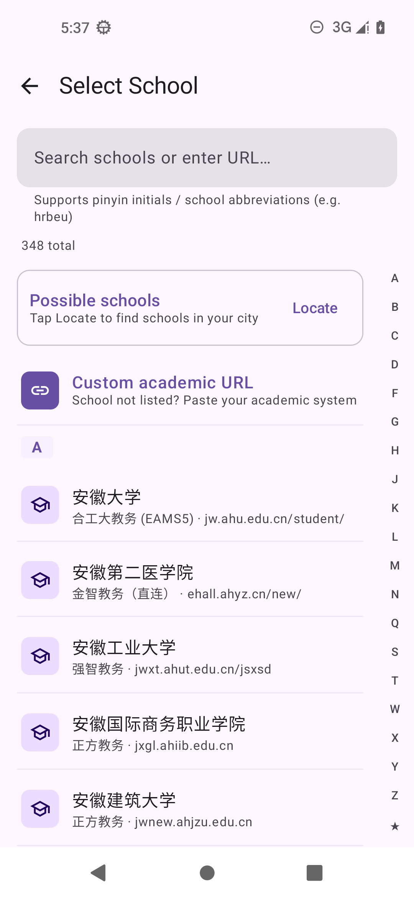
</p>

> School selector shown in English on the demo device

The school catalogue changes with each release. Choose a listed university for the maintained path, or enter a JW URL in the search field when your university is not listed. Sleepy will try to detect a protocol from the URL and open it for login and import. Success still depends on the university page, its login flow, and a compatible parser.

All catalogued school entries (349) with their JW login URLs and protocol types are listed in **[Supported Schools List](docs/schools-list.md)** — searchable by full name, abbreviation, or pinyin initials; also useful for verifying JW addresses and school renames.

If URL detection or parsing does not work, file an adaptation request with the JW URL and the observed failure. Use the **[collection guide](docs/adapt-kit/README.md)** only when more page or network data is needed. Never include an account, password, verification code, or other personal data in an issue. You can [open an adaptation request](https://github.com/lingion/sleepy/issues/new?template=school_adaptation.yml) directly.

### Supported Text Formats

| Format | Recognition |
|---|---|
| **WakeUp share text** | Starts with `【来自WakeUp课程表】` |
| **WakeUp JSON** | `.json` exported from Sleepy / WakeUp |
| **ICS calendar** | Standard iCalendar, often exportable from university systems |
| **CSV file** | `.csv` with header row, comma-separated |
| **HTML table** | `<table>` markup, parsed header-first |
| **Plain text** | One course per line, tab-separated |
| **sleepy-v1** | Sleepy's native plain-text format with a `chk` integrity field and deterministic records |

---

The preview shows courses and conflicts. Choose replacement, a new timetable, append non-conflicting courses, merge into a new timetable, or append including conflicts. JW import also asks you to review the timetable name, term start, and period times.

<p align="left">
  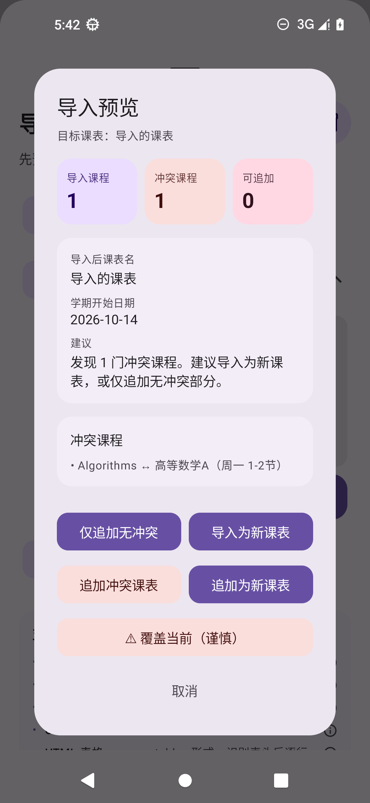
</p>

> Import conflict preview and five available actions

An interrupted JW import can be saved as a draft, resumed from management, or discarded. School selection supports search, a custom JW URL, and a Locate action for same-city suggestions.

The import sheet includes format instructions and examples. The plain-text guide offers a copyable prompt for converting screenshots with an image-capable AI tool of your choice; paste its output back into Sleepy for preview. Sleepy does not upload the screenshot or call an AI service itself.

<p align="left">
  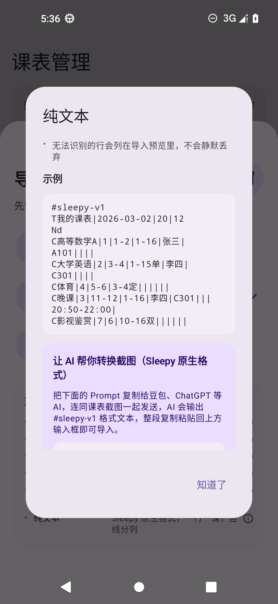
</p>

> Plain-text example and instructions for an external image-to-text tool

---

## Course Editing

<p align="left">
  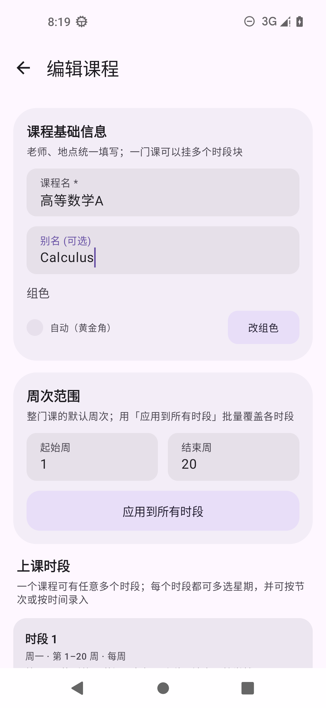
  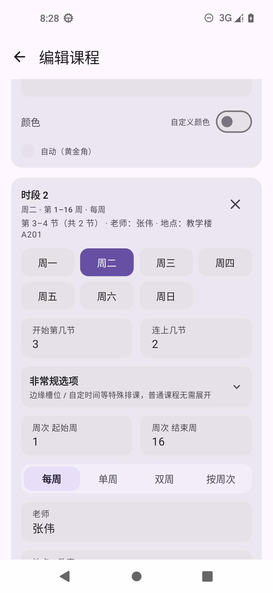
  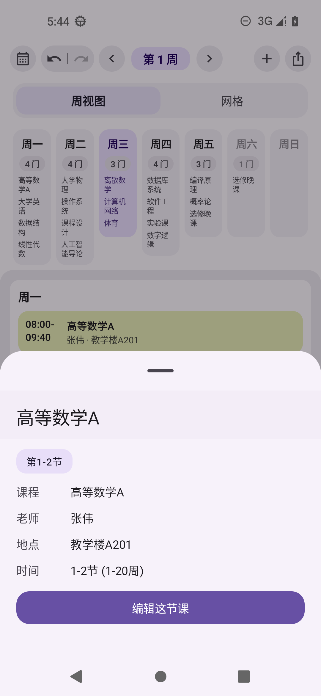
</p>

> Left: course editor with a filled alias. Middle: Second teaching slot: configure its weekdays, periods, weeks, and teacher independently. This is an unsaved fictional demonstration.
> Right: tapping a course card in week view opens the detail bottom sheet

A course may contain several teaching slots, each with its own teacher, room, note, weekday, periods, weeks, and odd/even selection. Apply week settings to all slots when needed. Optional aliases, group colors, and per-slot colors are supported; week/grid views and widgets independently choose whether to display aliases. Saving validates input and reports conflicts.

---

## Export Timetable / Period Table

Multiple export formats are available. File exports use `Download/Sleepy/` on Android 10+ and shared app-cache files on Android 8–9, then open the system share sheet; see the current Export screen for the exact list.

<p align="left">
  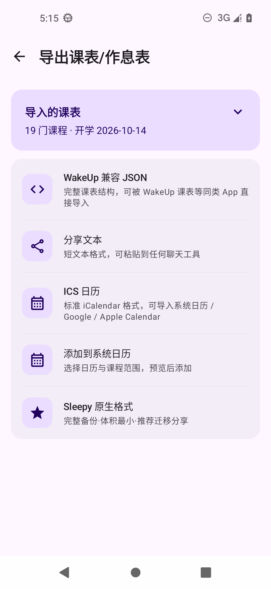
</p>

> Screenshot: export page ("Mine → Export Timetable / Period Table"); this image does not yet show the new XiaoAI entry.

The export screen first picks a course table or a period table (all course tables on top, a divider, then all period tables). Picking a **course table** offers four file/text formats plus XiaoAI and system-calendar actions; picking a **period table** narrows the list to two (JSON and sleepy-v1).

| Format | Use | Implementation |
|---|---|---|
| **WakeUp-compatible JSON** | Full timetable structure; importable by WakeUp and similar apps | `ScheduleExporter.exportWakeUpJson` |
| **Share text** | Compact text format (URL-encoded JSON); paste anywhere | `ScheduleExporter.exportWakeUpShareText` |
| **ICS calendar** | Standard iCalendar; import into system / Google / Apple Calendar | `ScheduleExporter.exportIcs` |
| **sleepy-v1** | Sleepy's native plain-text format for re-import or editing | `SleepyNativeExporter` |

File names use `sleepy_<name>_<timestamp>.json`, `.ics`, or `.sleepy`; share text opens the system text-sharing sheet directly.

The existing WakeUp share text format remains importable.

### XiaoAI Schedule

Select a course table and tap XiaoAI Schedule. Sleepy prepares the data locally and opens XiaoAI for preview; you confirm the import inside XiaoAI. Subsequent network access and data handling follow XiaoAI’s own rules. If no compatible XiaoAI app is installed, Sleepy displays an installation prompt.

This action supports weeks 1–30 and stops with a message for invalid dates, course weeks or periods. Periods must be numbered consecutively from 1, ordered by time and non-overlapping. XiaoAI requires 1–10 morning periods (before 13:00), and 0–10 afternoon (13:00–before 18:00) and evening periods each; afternoon-only or evening-only period tables are unsupported. Custom course times snap to the selected period table and do not preserve exact minutes.

### Add to the System Calendar

Export can write courses to a writable calendar on the device. Choose a calendar and range (next 7 days, next month, or remaining semester), optionally apply schedule transfers and regular calendar reminders, review the preview, then confirm. Calendar read/write permission is requested for this action. If the device has no writable calendar, Sleepy creates a local calendar without requiring a cloud account. First-period alarm reminders are experimental; actual alarm behavior depends on the calendar app and account.

---

## Home-screen Widgets (5 types, 13 variants)

Five widget types across 13 fixed-size variants: Today / TwoDay / WeekList each in regular / small / wide; WeekView / WeekGrid each in regular / small. Layouts adapt to launcher sizing.

| Widget | Variants | Shows | Screenshot |
|---|---|---|---|
| **Today** | regular / small / wide | Today's course list | <p align="left">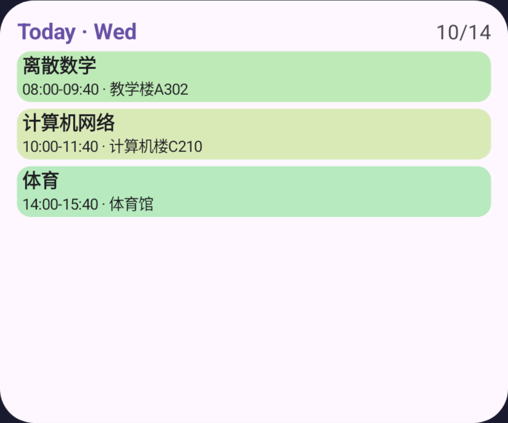</p> |
| **TwoDay** | regular / small / wide | Today + tomorrow, two columns | <p align="left">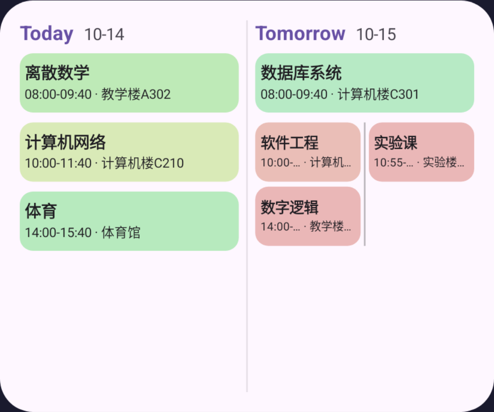</p> |
| **WeekList** | regular / small / wide | 7-day course summary + names | <p align="left">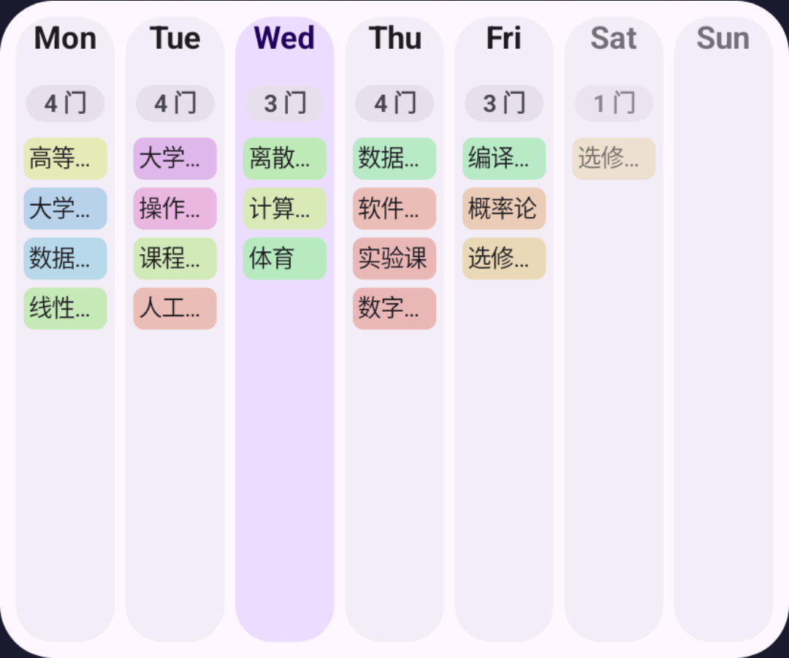</p> |
| **WeekView** | regular / small | Week-view thumbnail (theme-colored, no capsules) | 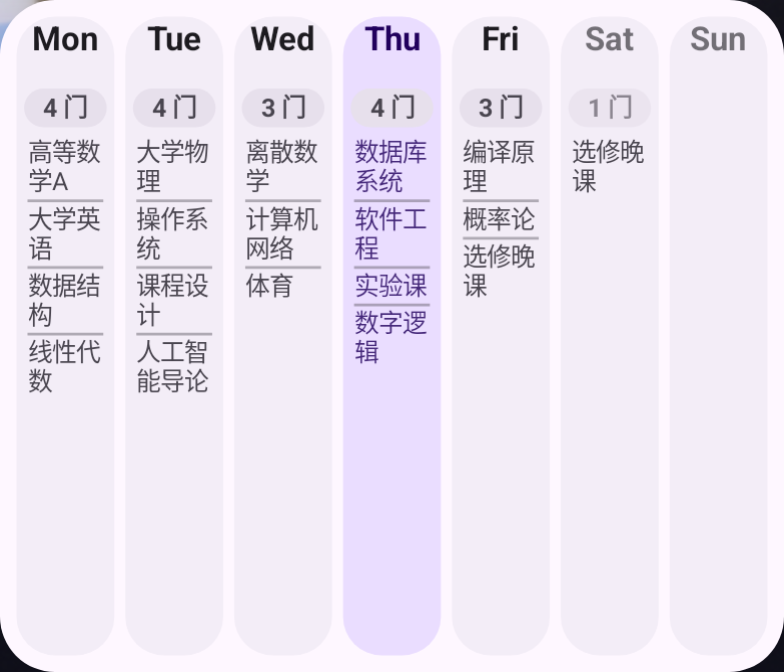 |
| **WeekGrid** | regular / small | Time grid + course blocks | <p align="left">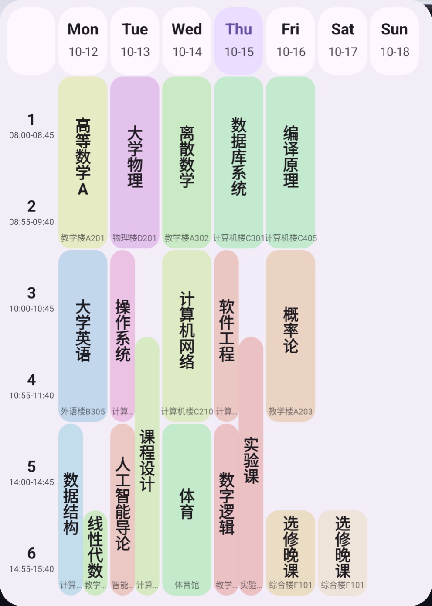</p> |

Image sources: Today, TwoDay, and WeekList are emulator previews produced by the current production renderer through `WidgetRenderActivity`, cropped to component bounds without stretching. WeekView and WeekGrid are actual launcher widget captures. This WeekGrid image shows visible periods 1–6, not every period or the entire term. Launcher size and widget variant determine the final layout and text truncation.

<p align="left">
  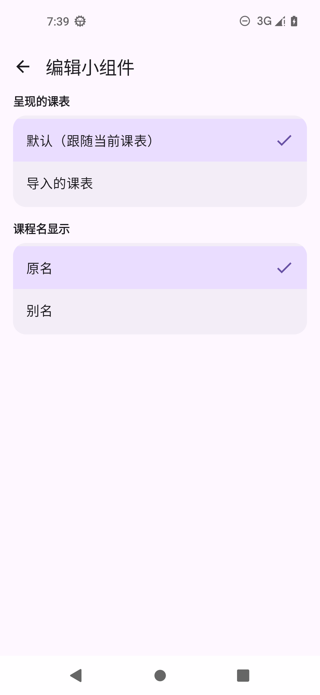
</p>

> Per-widget timetable binding and course-name display

Per-widget settings:

- General Settings → Widget management selects an installed widget and binds it to a fixed timetable or the currently selected timetable
- Each instance chooses original course names or aliases; eligible variants offer experimental scrolling
- Small WeekList and WeekView support three-day windows with today first or second
- Mine includes a refresh-all-widgets action

Implementation notes:

- All five use synchronous RemoteViews + Canvas rendering (since v1.0.29). Heavily customized launchers like OPPO freeze Glance's async SessionWorker, leaving stale cards — hence the port.
- **v1.0.55: fixed-size layout tiers** — each variant picks a layout for its own size bucket instead of stretching one layout
- **v1.0.55: experimental scrolling on some variants** (today / twoday / weeklist / weekview) when content exceeds the card height
- **v1.0.55: refresh at class start/end boundaries** — cards update as period boundaries are crossed
- Colors sync with the app theme in real time (dark mode + 5 presets)
- **Three render paths (main app / WeekGrid / screenshot renderer) share identical color logic**: course colors are distributed by golden-angle (137.508°) HSL hue from a hash of the course group — evenly spread and stable per course
- Refresh: `APPWIDGET_UPDATE` broadcast to all receivers (system-level) + WorkManager periodic refresh + class-boundary refresh

---

## Course Conflicts, Undo and Redo

When courses overlap, the grid keeps two layers visible and tapping the covered area rotates through the other courses. Three or more overlapping courses are not silently dropped; the stack style also works with any layer count.

When a manually added or edited course overlaps an existing course, the confirmation dialog lists the weekday, periods, actual overlapping weeks, and the conflicting course before saving.

The top bar includes Undo and Redo for timetable data changes. Switching the active timetable is navigation and does not create an undo entry.

Appearance → Schedule display offers stacked, folded-corner, and side-bar conflict styles with corresponding size controls.

<p align="left">
  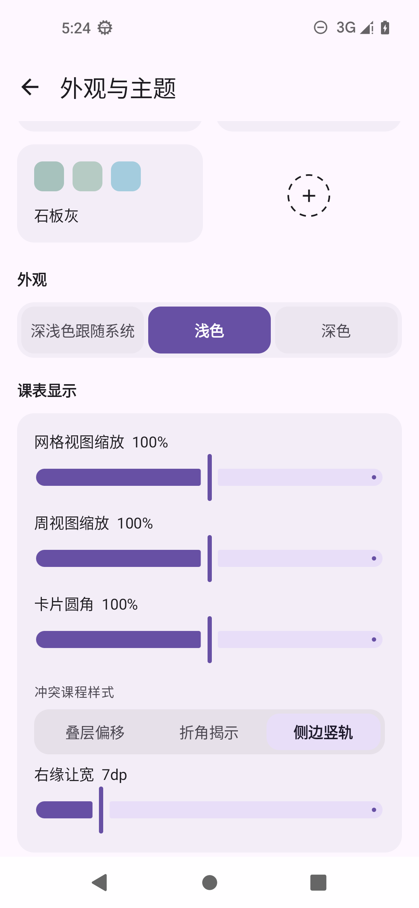
</p>

> Conflict style controls; see the grid view for overlapping courses

## OPPO Fluid Cloud

Since v1.0.37 the before-class reminder supports a Fluid Cloud style: `FluidCloudService` (foreground service) renders course name, time, and room via `NotificationCompat.ProgressStyle`, with a progress bar that advances toward class time, persistently visible in the status bar (off by default). OPPO/OnePlus Seedling card integration materials are ready but **not yet wired into the build**.

- OPPO `SeedlingSupportSDK-lite 3.0.7` AAR sits in `app/libs/` (minSdk 26); gradle does not yet declare the dependency; `SeedlingCardWidgetProvider` is unimplemented
- UPK source project in [`oppo-fluid-cloud-upk/`](oppo-fluid-cloud-upk/) (API 2.0, `immediate` trigger, `notification/statusbar` entry)
- OPPO-assigned values (`identifier`, `intent`, etc.) remain as `REPLACE_WITH_OPPO_*` placeholders — see that directory's README

---

## Notifications & Reminders

Entry: "Mine" → "Reminders". The master toggle is off by default; turning it on requests notification permission — a denial snaps it back off, and asking again works (not one-shot).

<p align="left">
  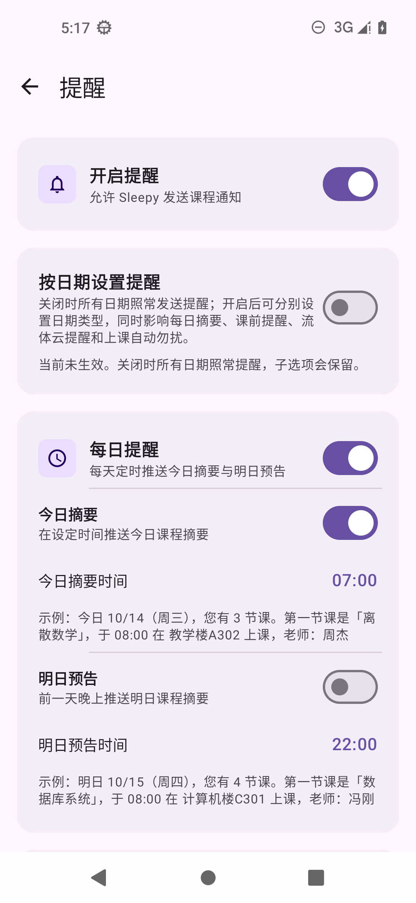
  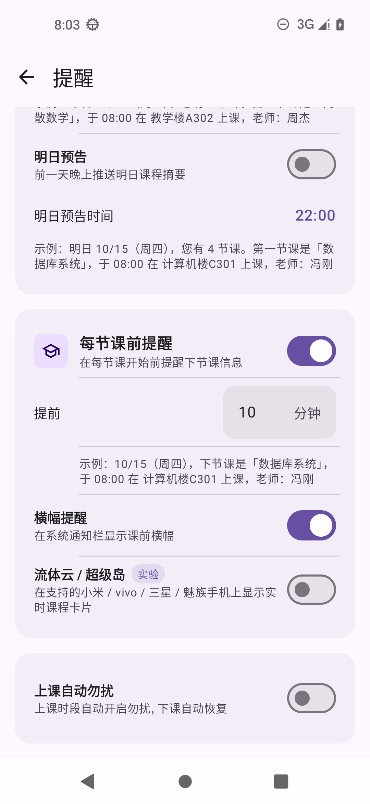
</p>

| Feature | Trigger | Content (dynamically generated) |
|---|---|---|
| **Daily reminder** | User-set time each day | `Today the 15th: 3 classes. First class Calculus at 08:00 in Building A101` |
| **Tomorrow summary** | Its own user-set time | Tomorrow’s course schedule |
| **Before-class reminder** | N minutes before each class | `Next class Calculus at 08:00 in Building A101` |

- The minutes-before value is **free input** (1–999, capsule-style field, no hardcoded options)
- Reminder content **queries the day's timetable live**; on empty days it pushes "Today the Xth, no classes"
- Notifications go through `AlarmManager` exact/inexact dual-path fallback, Android 12+ compatible
- `BootReceiver` re-registers after reboot/app update
- Master toggle state persists locally (`AppPrefs`, SharedPreferences)
- **Per-timetable reminders**: open Mine → Reminders → Timetable reminders to see every timetable and toggle each one. Changes save immediately and retain existing choices. You can configure them while the master switch is off; they take effect when it is enabled. The timetable editor no longer contains this switch.
- Today, tomorrow, and before-class reminders provide live schedule previews
- Date rules distinguish public holidays, transferred days, make-up workdays, and ordinary weekends
- Before-class reminders can use a notification banner and experimental live notifications; the page includes main-field selection, a test action, and notification/alarm/battery reliability diagnostics
- Optional automatic Do Not Disturb during class; it restores the previous state at the class boundary and remains vendor/permission dependent

---

Schedule transfers select courses using the source date’s teaching week, odd/even weeks, and week range, then place them on the destination date. The source day is cleared and the destination’s original courses are replaced, including transfers across weeks or between the same weekday.

## About

Entry: "Mine" → "About". A dedicated page showing version, author, and open-source info.

<p align="left">
  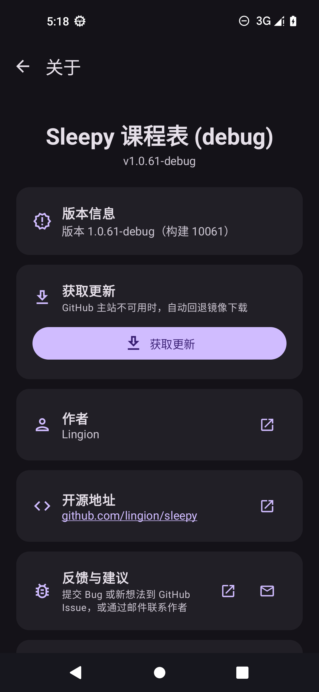
</p>

| Section | Content |
|---|---|
| **Version** | Version + build number (`BuildConfig.VERSION_NAME` / `VERSION_CODE`) |
| **Author** | Lingion, tap to open the GitHub profile |
| **Source** | github.com/lingion/sleepy, tappable |
| **License note** | GPL-3.0 summary; contributions welcome |
| **Open-source acknowledgements** | 9 cross-school projects plus per-school credit cards, their licenses, and the parts of Sleepy they informed |

The About page offers manual update checks and a startup-check switch. Startup checks are enabled by default and can be disabled. Checks contact the update service; full release notes are shown before downloading, and downloads can be cancelled.

---

## Dark Mode, Custom Themes and Timetable Appearance

Multiple presets + follow-system, each with Light/Dark schemes. Switch in "Mine" → "Appearance & theme".

<p align="left">
  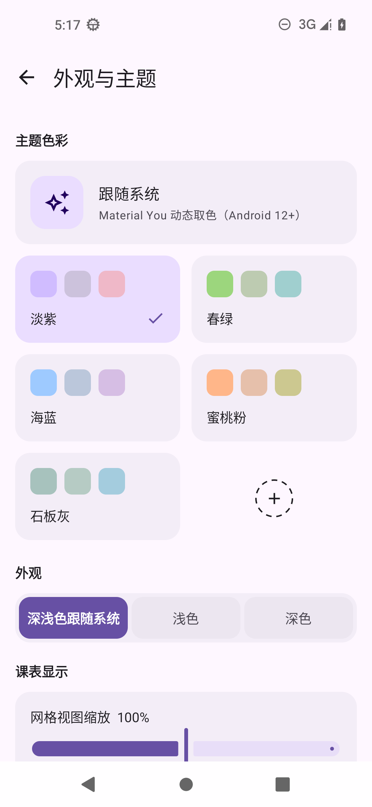
  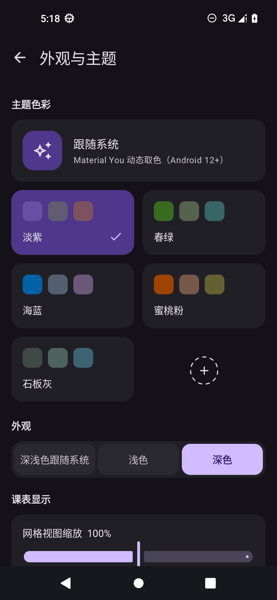
</p>

| Theme | Feel |
|---|---|
| Default lavender | Material 3 purple |
| Spring green | Matcha |
| Ocean blue | Calm cool tones |
| Peach pink | Warm orange |
| Slate gray | Neutral |
| Follow system | Use system theme colors |

Theme colors and light/dark mode are independent: follow the system or force light or dark. Create a custom theme randomly, derive it from a main color, or edit primary, secondary, tertiary, and neutral surface colors with live preview. Custom themes can be saved, renamed, and deleted; theme changes refresh widgets.

<p align="left">
  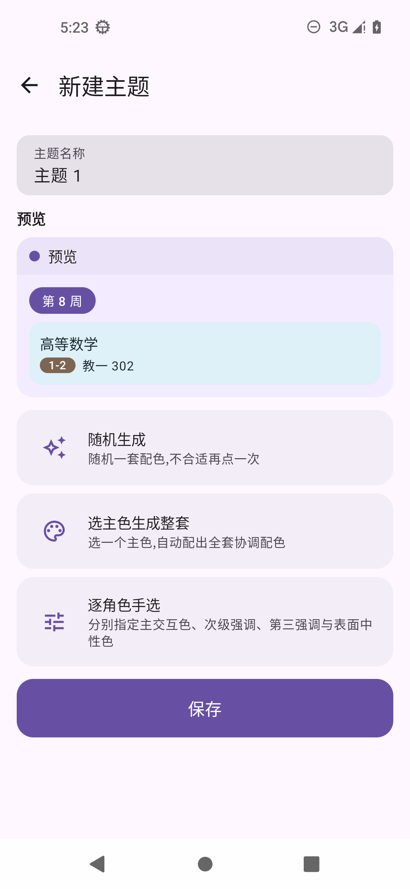
</p>

> Custom theme creation and live preview

Appearance also controls course-block scale and corners, conflict styles, and period headers: traditional/three-line layout, visible text, and hanging offset.

<p align="left">
  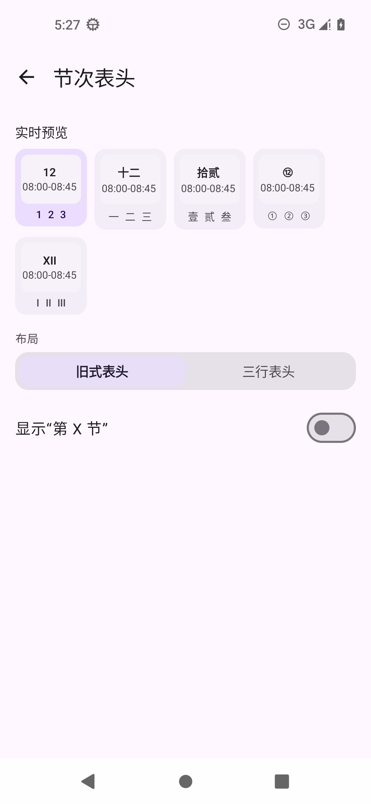
</p>

> Period header styles and layout

---

## Timetable Management and General Settings

<p align="left">
  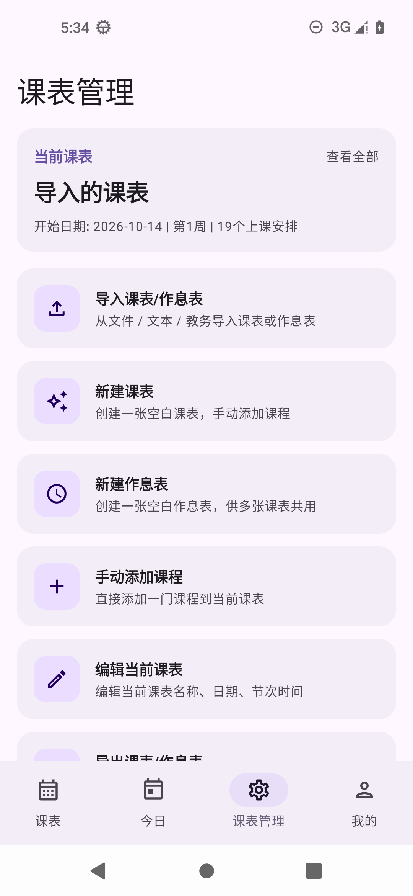
</p>

Management collects the current timetable summary, import and drafts, new timetable/period table, manual course entry, edit, and export actions.

Mine → General Settings includes:

<p align="left">
  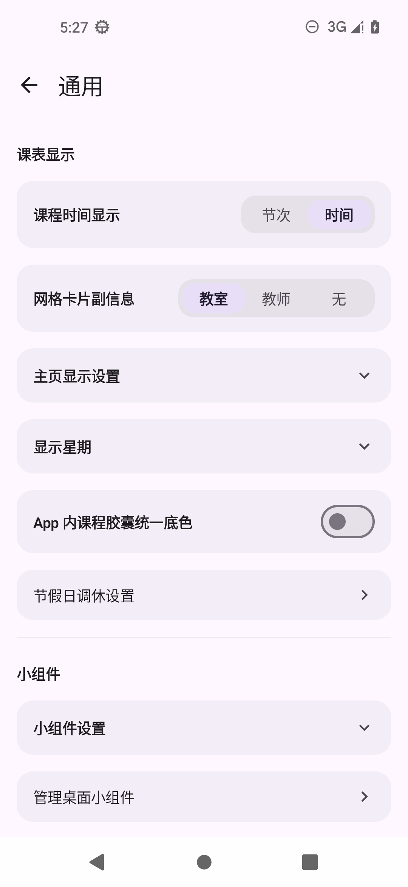
  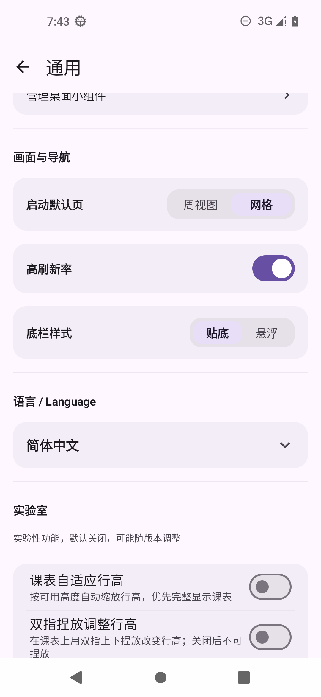
</p>

> General settings: timetable display and widget entry

| Group | Controls |
|---|---|
| Course information | Period numbers or clock times, room/teacher/hidden grid subtitles, separate week/grid alias settings |
| Week layout | Two columns, by-day or balanced columns, hide empty days |
| Visible content | Selected weekdays, dates, view switcher, colorless courses |
| Global widgets | Colorless mode, separators, nearest busy day, widget management |
| Navigation and language | Start view, high refresh rate, docked/floating bottom navigation, Chinese (simplified/traditional), English, Japanese, Spanish |
| Experimental | Adaptive grid height, pinch zoom, hide empty evening periods, vertical punctuation, separators and long-break spacing |

### Holidays and Schedule Transfers

<p align="left">
  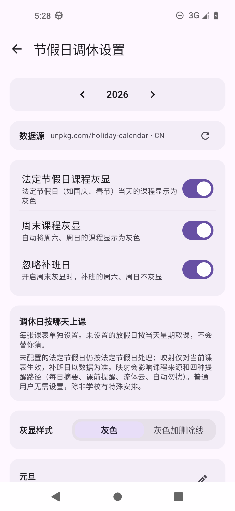
</p>

> Holiday appearance and transfer settings

General Settings → Holiday settings lets you change years, refresh Chinese holiday data, gray out public holidays/weekends, and exempt make-up workdays. Add, edit, remove, or restore custom date ranges.

Each timetable can map a transfer date to another date’s courses. These mappings affect course selection and the date logic for daily summaries, before-class reminders, live notifications, and automatic DND. Visual holiday treatment and reminder date rules are separate controls.

### Full Backup and Migration

<p align="left">
  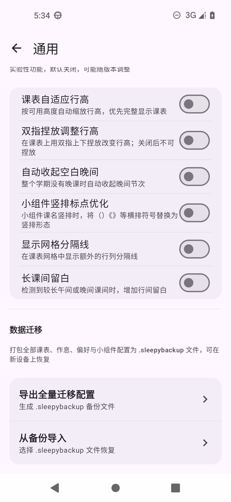
</p>

> Experimental settings and full migration entry

General Settings → Data migration exports timetable and period-table data, preferences, and widget settings to `.sleepybackup`. Restore offers **Merge** (keep local timetables and append; matching preference keys take the backup values) or **Overwrite** (replace the timetable/settings modules included in the backup). This is a whole-app migration package, distinct from a single timetable’s JSON/ICS/text export; Android’s document picker chooses the file location.

---

## Tech Stack

```
language        = Kotlin 2.1.10
ui              = Jetpack Compose (BOM 2026.09.00) + Material 3 1.5.0-alpha28
navigation      = Navigation 3 runtime/ui 1.1.7 + navigationevent-compose 1.1.2
storage         = Room 2.7.0 (KSP)
prefs           = SharedPreferences (AppPrefs); DataStore 1.1.1 declared, unused
serialization   = kotlinx-serialization-json 1.6.3
html_parser     = jsoup 1.18.1
widgets         = RemoteViews + Canvas (synchronous; Glance removed)
background      = WorkManager 2.9.1
image           = Coil Compose 2.7.0
splash          = Core Splash Screen 1.0.1
core_ktx        = AndroidX Core 1.17.0
build           = AGP 9.1.1 + Gradle 9.3.1 (Kotlin DSL)
java_compat     = 17
```

---

## Project Structure

```
sleepy/                                    # Repository root
├── app/
│   ├── src/main/
│   │   ├── java/com/lingion/sleepy/
│   │   │   ├── MainActivity.kt           # Single-activity entry
│   │   │   ├── SleepyApp.kt              # Application (DI, notification scheduler)
│   │   │   ├── data/
│   │   │   │   ├── AppDatabase.kt        # Room database
│   │   │   │   ├── dao/                  # CourseDao / TimeTableDao
│   │   │   │   ├── entity/               # CourseEntity / TimeTableEntity / SmartPeriodConfig
│   │   │   │   ├── jw/                   # JW parsers + JwImportViewModel + JwParity
│   │   │   │   ├── parser/               # ScheduleParser + SleepyNativeParser/Exporter/Format
│   │   │   │   ├── repository/           # ScheduleRepository
│   │   │   │   └── undo/                 # UndoManager
│   │   │   ├── ui/
│   │   │   │   ├── component/            # CourseTableView / CourseDetailSheet /
│   │   │   │   │                         # SmartPeriodEditor / TimeSlotEditor /
│   │   │   │   │                         # PillNavigationBar / SegmentedSwitcher /
│   │   │   │   │                         # ConflictCard / DateTimePickers / SettingsCards /
│   │   │   │   │                         # ShareScheduleSheet / SleepyMotion
│   │   │   │   ├── screen/
│   │   │   │   │   ├── schedule/         # Week view + grid view
│   │   │   │   │   ├── today/            # Today view
│   │   │   │   │   ├── edit/             # Course editing
│   │   │   │   │   ├── imports/          # JW import + text import + school picker
│   │   │   │   │   ├── manage/           # Course management
│   │   │   │   │   └── mine/             # Mine / all timetables / edit / theme / export
│   │   │   │   └── theme/                # Theme + ThemePresets + NoRippleClickable
│   │   │   ├── util/                     # AppPrefs / DateUtils / LocaleHelper /
│   │   │   │                             # TimeTableUtils / CourseColorUtil /
│   │   │   │                             # ConflictLayoutEngine / ConflictDetailReporter /
│   │   │   │                             # WeekRangeOverlap / HolidayManager / HolidayRange /
│   │   │   │                             # HighRefreshRate / PinyinMatcher / MarkdownBlocks /
│   │   │   │                             # FeedbackComposer / UpdateManager / UpdateInfo /
│   │   │   │                             # UpdateNotifier / VersionUtils
│   │   │   └── widget/                   # Widget Kotlin files + notification/ subdirectory
│   │   │                                 # (Today/WeekList/WeekView/TwoDay/WeekGrid × Provider + Receiver)
│   │   │                                 # + WidgetRenderActivity + RemoteViewsWidgetHelper +
│   │   │                                 # WidgetContent / WidgetBitmapRenderers /
│   │   │                                 # WidgetTableResolver / WidgetUpdateWorker /
│   │   │                                 # WidgetUpdater / WidgetVariant + WeekGridPreviewActivity
│   │   │       └── notification/         # CourseNotificationScheduler + FluidCloudService
│   │   └── res/
│   │       ├── drawable/                 # Vector icons
│   │       ├── drawable-nodpi/           # Non-density bitmap assets
│   │       ├── layout/                   # RemoteViews layouts
│   │       ├── mipmap-anydpi-v26/        # Adaptive launcher icons
│   │       ├── mipmap-{hdpi,mdpi,xhdpi,xxhdpi,xxxhdpi}/
│   │       ├── values/                   # Default resources (zh-CN)
│   │       ├── values-zh-rCN/            # Chinese simplified
│   │       ├── values-zh-rTW/            # Chinese traditional
│   │       ├── values-en/                # English
│   │       ├── values-ja/                # Japanese
│   │       ├── values-es/                # Spanish
│   │       └── xml/                      # 13 widget_info + network/backup rules
│   └── libs/                             # seedling-support-lite-3.0.7.aar (dependency not declared)
├── docs/
│   ├── screenshots/                      # README screenshots
│   ├── logo.png                          # Top-of-README logo
│   ├── adapt-kit/                        # Adaptation collection guide (separate README)
│   └── sop/                              # SOP index (does not enumerate any specific file)
├── assets/                               # logo_1024.png original
├── oppo-fluid-cloud-upk/                 # OPPO Fluid Cloud UPK source (not wired into the build)
├── artifacts/                            # Build output archive
├── scripts/                              # release_check.sh
├── tools/                                # gen_widget_previews.py + sleepy-collector
├── tasks/                                # plan.md + todo.md
├── build.gradle.kts                       # Root build (AGP 9.1.1 / Kotlin 2.1.10 / KSP)
├── app/build.gradle.kts                   # App module (compileSdk=37 / minSdk=26 / targetSdk=37)
├── settings.gradle.kts                   # rootProject.name = "WakeUpPure"
├── gradle.properties                     # android.disallowKotlinSourceSets=false
├── gradlew                                # Unix Gradle Wrapper
├── gradlew.bat                            # Windows Gradle Wrapper (PR #16)
├── gradle/wrapper/                        # gradle-wrapper.properties (Gradle 9.3.1)
└── LICENSE                                # GPL-3.0
```

---

## Build & Install

### Prerequisites

Build with the bundled **Gradle 9.8.1 Wrapper + Android Gradle Plugin (AGP) 9.3.3**. Android Studio must support AGP 9.3; see the [official AGP 9.3 compatibility requirements](https://developer.android.com/build/releases/agp-9-3-0-release-notes).

```bash
java -version           # JDK 17+

sdkmanager "platforms;android-37.0" "build-tools;36.0.0"
```

The current Gradle configuration resolves to `compileSdk=37` and `buildToolsVersion=36.0.0`; the platform package identifier is `platforms;android-37.0`.

If you see `SDK XML versions up to 3` / `SDK XML file of version 4`, build through this repository's `gradlew` / `gradlew.bat` and update **Android SDK Command-line Tools (latest)** under Android Studio's SDK Manager → SDK Tools. The IDE, `ANDROID_HOME`, and `sdk.dir` in `local.properties` should use the same SDK. Run its `cmdline-tools/latest/bin/sdkmanager` (`sdkmanager.bat` on Windows), and check that `PATH` does not select an older `tools/bin/sdkmanager`. See the [official sdkmanager documentation](https://developer.android.com/tools/sdkmanager).

### Build

Linux / macOS:

```bash
git clone https://github.com/lingion/sleepy.git
cd sleepy

# Debug (x86_64 emulator / arm64 device)
./gradlew assembleDebug
```

Native Windows (PowerShell / CMD; no WSL or Git Bash required):

1. Install JDK 17 or 21. Set `JAVA_HOME` to the JDK root directory (not `bin`), or add the JDK's `bin` directory to `PATH`.
2. Install Android SDK Platform 37 and the required Build Tools using Android Studio's SDK Manager or the command-line tools. Set `ANDROID_HOME` to the SDK root directory, or add `sdk.dir=C:/Users/your-name/AppData/Local/Android/Sdk` to `local.properties` in the project root (use forward slashes and your actual SDK path; this file is ignored by Git).
3. Run these commands from the project root:

```powershell
java -version
.\gradlew.bat --version
.\gradlew.bat assembleDebug
# Optional: run unit tests or remove build outputs
.\gradlew.bat testDebugUnitTest
.\gradlew.bat clean
```

The wrapper downloads the Gradle version specified in `gradle/wrapper/gradle-wrapper.properties`, so a separate Gradle installation is unnecessary. The first build requires internet access to download Gradle and dependencies. Debug APKs are written to `app/build/outputs/apk/debug/`.

### Install

```bash
adb install app/build/outputs/apk/debug/app-arm64-v8a-debug.apk
# or x86_64 emulator
adb install app/build/outputs/apk/debug/app-x86_64-debug.apk
```

> ABI splits: arm64-v8a (mainstream devices), armeabi-v7a (32-bit legacy), x86_64 (emulators). Choose the APK matching your device ABI, or use the universal APK.

---

Debug builds use `com.lingion.sleepy.debug` and a separate data sandbox from the release app. Releases also provide a universal APK. See [GitHub Releases](https://github.com/lingion/sleepy/releases/latest) for installable release files and checksums.

CI runs on pull requests to `main` (commit lint, collector checks, Android tests, Android lint, and APK assembly). Tagged `v*.*.*` pushes trigger the release workflow; neither CI nor Release currently supports manual dispatch. Source: [CI](.github/workflows/ci.yml) and [Release](.github/workflows/release.yml).

## Permissions and Network Access

Timetable viewing and editing work offline. JW import contacts the selected school, holiday refresh downloads public calendar data, and update checks/downloads contact GitHub or the project mirror. Notification permission is requested when reminders are enabled; optional class-time DND needs system notification-policy access. Location is requested after Locate in school selection. Adding courses to the system calendar requests calendar read/write access; installing an in-app update requires permission to install unknown apps. Exact-alarm and battery settings affect reminder reliability and are surfaced on the reminder page.

## Community

Bug reports and new-school adaptation requests belong in [Issues](https://github.com/lingion/sleepy/issues). To chat, suggest features, or hear about new releases first, join the QQ group:

**QQ group: `1063407652`** (search the number in QQ and request to join)

Prefer to stay on GitHub? [Discussions](https://github.com/lingion/sleepy/discussions) get the same attention.

## Documentation

- **[Try Online](https://sleepy.qdp.qzz.io)** — Web timetable, opens in the browser with no install; supports multi-format import (WakeUp share text / ICS / CSV / Excel), data stays local
- **[Wiki](https://github.com/lingion/sleepy/wiki)** — per-screen guides, all import/export formats, widget families, reminder internals, architecture and codebase map, all cross-linked from the sidebar
- **[Operation Guide](https://blog.qdp.qzz.io/docs/sleepy/overview)** — step-by-step user manual covering installation, import, widgets, themes, and troubleshooting
- **[Technical Write-up](https://blog.qdp.qzz.io/sleepy-material-you-schedule)** — architecture deep-dive: schedule parser engine, gold-angle HSL, Wisedu reverse-engineering, widget rendering pipeline

---

## License

[GPL-3.0](LICENSE)

Sleepy is released under GPL-3.0. The JW adapters, protocol research, and timetable formats reference multiple open-source projects. The complete list — 9 cross-school projects plus per-school credit cards, with licenses and reference scope — is available in the app under Mine → About → Open-source acknowledgements.

---

<p align="center">
  <sub>No shell. No bloat. Just a timetable.</sub>
</p>
