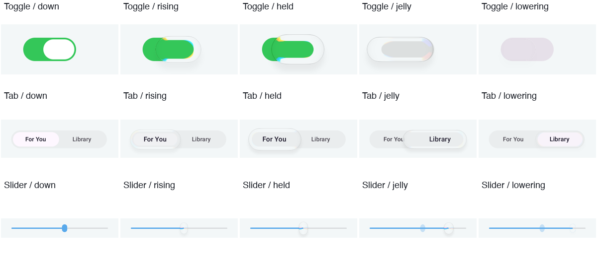
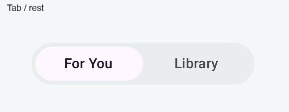
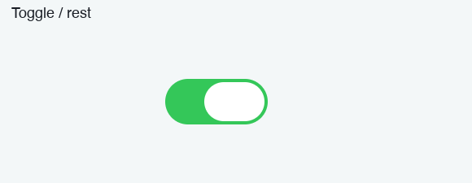
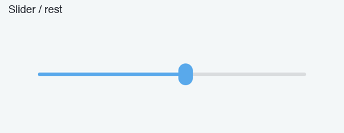
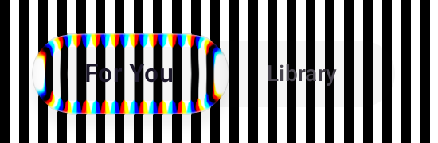

# 液态控件动态验收

Toggle、Tab 和 Slider 共用现有 Dock 的升降、跟随、落位和果冻弹簧。参考源码是本地 FLClash 的 `lib/ui/navigation_dock.dart` 与 Sleepy 的 `LiquidGlassNavigationBar.kt`、`LiquidGlassPhysics.kt`。轮廓继续对照 iOS 参考 f_028 至 f_054；这些静态帧不能单独证明升降时间或物理震动。

完成条件为渐进升降、速度驱动的果冻形变、真实采样产生的彩虹边缘。最终 Android 逐帧图像和尺寸记录附在本文后半部分。

## 层级和运动不变量

```text
手指按下                 手指移动                  松手落位
尺寸沿弹簧渐进增大       跟随弹簧保留速度          到位且升够后渐进降低
       +----------+       +-------------+             +----------+
轨道 --|----------|--  ---|-------------|---      ----|----------|----
       +----------+       +-------------+             +----------+
镜片始终位于轨道和文字上层；轨道保持原尺寸；实际镜片参与测量和采样。
```

Tab 轨道高42dp，静置滑块高34dp，完整按住时镜片高52dp；果冻横向拉伸时至少保持44dp，确保上下仍越过轨道。Toggle 静置37乘24dp，完整按住时63.6乘36dp。Slider 保持有色16乘24dp小竖椭圆，完整按住时28乘40dp；运动中的宽高再随速度形变。这些都是实际尺寸，不能通过缩放已采样纹理实现。

| 行为 | 实际使用参数 |
| --- | --- |
| 升起和落下 | FLClash LiftSpring，duration参数250ms、bounce为0的临界阻尼解析弹簧；不是250ms线性动画。 |
| 手指跟随 | stiffness为1024，damping ratio为0.9。 |
| 落位 | TravelSpring，duration参数400ms，bounce为0.15；中途改目标保留当前位置和速度。 |
| 果冻 | stiffness为100，damping ratio为0.4；沿用现有Dock的speed 2.4、stretch 0.24、squash 0.16、aspect 1.35。 |
| 抬手门控 | 按压结束、升起程度至少0.975、距目标至多0.04逻辑行程后落下；没有固定200ms延时。 |
| 边缘色散 | 轨道透镜dispersion为6.5，独立内容透镜为3.6，随升起程度渐进。 |

拖动时只用速度驱动拉伸，避免指针事件抖动引起瞬时刹车形变；落位时加入减速压缩和回弹。这一细节沿用现有Dock。短点按也先升够并到位再落下，减小动态效果设置为零时直接收束，不遗留活动帧循环。经典模式继续原有控件行为。

## 实际渲染方法

Android API33使用项目原有RuntimeShader。每次截帧先等待HWUI真实提交，再通过PixelCopy获取窗口。暂停Compose时钟后逐帧推进并等待布局、绘制完成，避免把过期截图与新尺寸配对。

浅灰轨道与浅灰背景的差异很小，普通场景中的彩虹边缘应保持轻微。另设黑白条纹诊断场景：输入本身无彩色，镜片区域出现明显RGB差异才计为实际通道分离；不能拿绿色Toggle或蓝色Slider的原色证明色散。诊断图与普通场景分别保存。

## 原始要求与实现核验

| 用户原话 | 实现行为和证据 |
| --- | --- |
| “缓缓地抬起来”“缓缓地优雅落下” | 共用Dock升降弹簧，记录升起和落下尺寸序列；旧固定暂留实现会被时间回归测试检出。 |
| “边缘是有彩虹一样的折射” | 恢复两遍透镜的原始色散参数，并检查黑白源在真实着色器中产生RGB分离。 |
| “弹簧一样的伸缩”“果冻一样的效果” | 速度驱动拉伸，减速驱动压缩，低阻尼弹簧回弹；逐帧记录移动宽高。 |
| “上边界和下边界都要超过轨道” | 镜片中心保持在轨道中心，Tab在强拉伸时仍高于42dp轨道。 |
| “移动的时候有震动” | 保留按下和跨选项反馈接线；模拟器无法确认手机振动强度和实际手感。 |

## 最终实测

API33模拟器的两项渲染测试通过。按住、拖动和落下共采集129张动态截图，另存静态明暗场景与黑白色散诊断图。中性黑白源的Tab区域出现6093个RGB通道差超过65的像素，普通浅灰背景保持轻微色边。诊断图用于证明采样和通道分离，不能作为普通页面的饱和度目标。

| 控件 | 按住宽高 | 拖动最大宽度 | 拖动最小高度 | 最终静置高度 |
| --- | --- | --- | --- | --- |
| Tab | 124乘52dp | 150.5dp | 44dp | 34dp |
| Toggle | 63.5乘36dp | 79.5dp | 30dp | 24dp |
| Slider | 28乘40dp | 30dp | 36dp | 24dp |

Tab的连续升起高度依次为34、37.5、42.5、46.5、49、50.5、51、51.5、52dp。拖动松手后的采样高度依次为44、42、38.5、35.5、34.5、34dp，完整原始尺寸序列见[motion-samples.csv](evidence/glass-control-motion-20261109/motion-samples.csv)。纯物理测试另行检查减速压缩、反向拖动的速度连续性、短点按门控和禁用动态效果后的停帧。











GIF由上述实际帧顺序生成，升起间隔32ms、拖动间隔16ms、落下间隔64ms；按住和静置阶段延长展示。视觉验收来自模拟器HWUI，尚无本轮手机触感与GPU性能实测结论。Android13之前的既有模糊降级无法提供RuntimeShader级折射。
