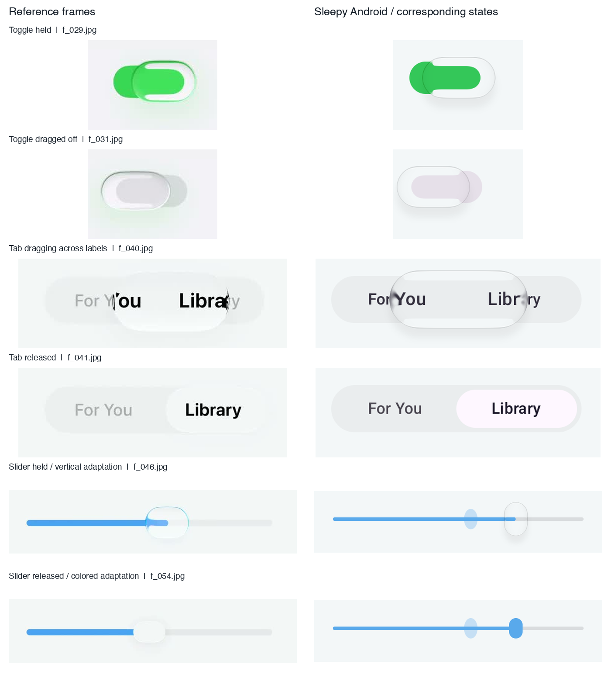
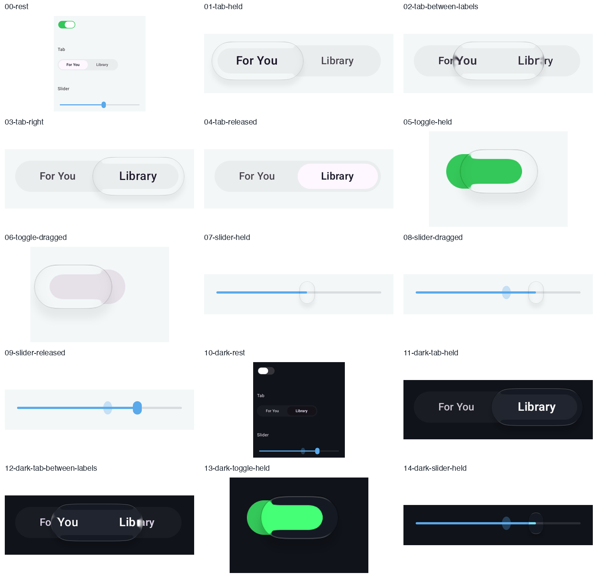
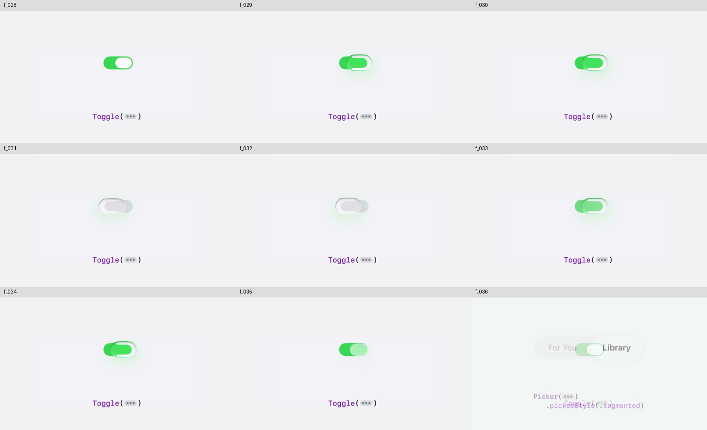
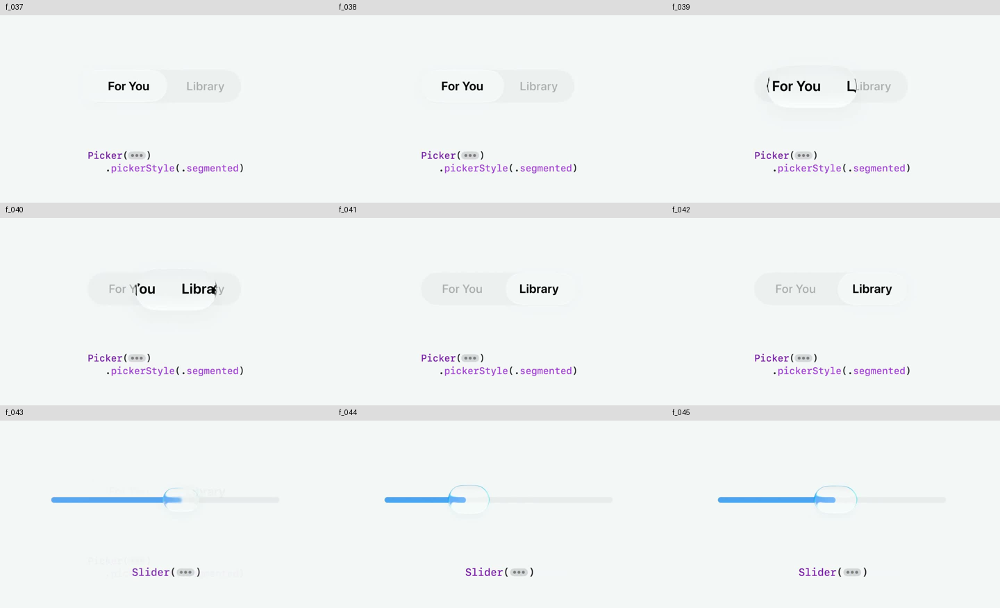
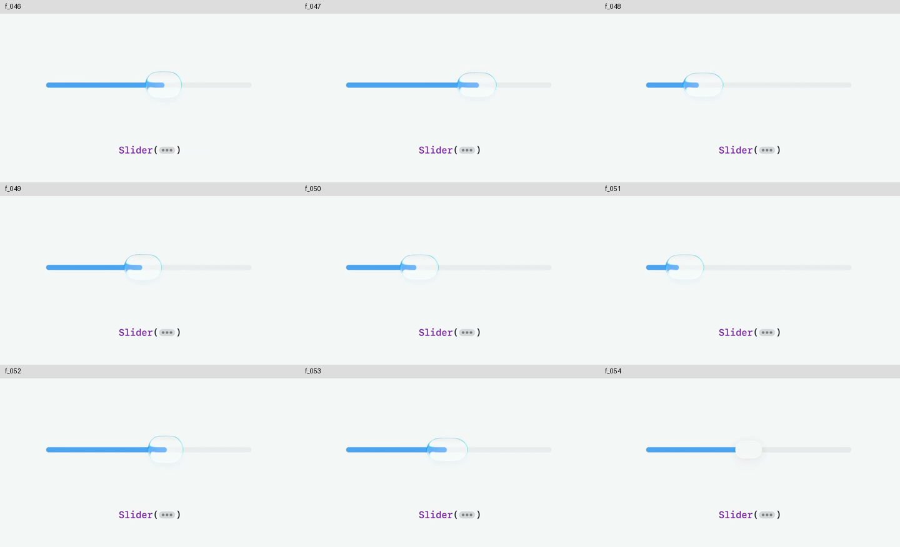

# PR 299 悬浮控件验收

本轮以 f_028.jpg 至 f_054.jpg 全部二十七帧为视觉依据。f_028 至 f_035 是开关，f_036 是转场，f_037 至 f_042 是分段选择，f_043 至 f_054 是滑杆。参考图源目录为 docs/liquid-glass-ios27/evidence/ios27-toggle-recon/img/frames。

完成条件有三项。按住 Tab 后，镜片围绕原中心放大，上下边界均越过轨道，完整处在轨道上层。镜片必须采到普通轨道和文字，拖动时能看到折射，并在跨选项时触发选择震动。液态风格的滑杆采用细轨道和有颜色的小竖椭圆，按住后升为真实透镜，同时保留整数吸附、原值幽灵、无障碍调值和滚动冻结。

层级和位置是实现不变量：

```text
上层       完整的悬浮镜片，围绕原中心生长
            +----------------------+
轨道上缘 ---|----------------------|---
轨道        |  轨道和文字进入采样   |
轨道下缘 ---|----------------------|---
            +----------------------+
下层       普通背景、静置滑块和文字
```

轨道和文字各有独立的兄弟采样源，绝不能把包含镜片的祖先录入采样源。Tab 的静置轨道为 42dp，内侧滑块为 34dp，按住后镜片为 52dp，因此上下各超出轨道 5dp。横向围绕原滑块中心增宽 16dp。外层透镜弯曲轨道，最后的内容透镜单独折射文字；镜片外显示原始标签，镜片内显示光学结果，同一份标签保留原有语义。

内容透镜沿用 FLClash 的独立两遍实现。标签的离屏采样按每个选项中心放大百分之十六，再经过 refraction 为 14、bevel 为 11.2 的内容曲率。只用外层负折射的旧方案，按住前后标签像素宽度均为 93px，无法提供参考中的文字放大。渲染测试现在直接检查按住后的实际字形至少增宽百分之十，避免几何测试通过而镜内文字仍然没有变化。本轮最终截图实测为静置93px、按住108px，比值为1.161。

滑杆静置滑块为 16乘24dp 的有色竖椭圆，按住后为 28乘40dp，轨道为 4dp 连续圆角细线。单头、双头、色相、显示设置和节次表头设置共用这一交互。经典风格仍使用原有样式。

光学曲率继承现有 Dock 的 LiquidGlassStyle.lens，由 controlLens 统一关闭其 6.5dp 的通道分离。参考中的绿色和蓝色边缘来自轨道本身，不能把强色散造成的粉色与青色条纹当成折射。开关、Tab、滑杆使用同一控件参数来源。采样在宿主普通背景上合成控件本地的普通轨道；不得只采透明轨道外的空白。

Toggle 的浮起尺寸直接参与测量，不再用 graphicsLayer 缩放已经采样的纹理。后者会连带放大轨道，造成镜内上下留白不对称。Tab 轨道为普通胶囊，采样内容与可见轨道保持一致。悬浮阴影共用 FLClash 的半径 5dp、向下偏移 8dp、浅色不透明度 0.055，深色强度为三倍，轮廓跟随实际镜片。

原实现上新增的两项回归均失败：Tab 下边界未越过轨道，滑杆仍为大横向胶囊。修改后的交互测试和实际渲染结果由本地报告记录。单测通过仅证明所断言的几何和行为，不等于视觉一比一通过。模拟器没有可感知的物理振子，震动接线与真机手感需分别说明。


FLClash 依据是本地完整克隆中的 `lib/ui/` 源码。`navigation_dock.dart` 的 `_GlassLens` 用 Positioned.directional 的实际宽、高和位置定义镜片，`_LensContent` 把文字单独采样折射，`_lensShadows` 定义轻阴影；本轮复用实际尺寸、绘制先后、真实采样和阴影的做法。该本地版本的 `segmented_control.dart` 是普通分段实现，不作为液态 Tab 的真源。三个控件的最终交互依据仍是上述二十七帧。

原始要求与实现行为核对如下。

| 原始要求 | 实现行为与验证方式 |
| --- | --- |
| 上边界和下边界都要超过轨道 | 默认 42dp Tab 轨道按住后有 52dp 镜片，围绕原中心上下各越出 5dp，布局断言检查真实边界。 |
| 完整的一个玻璃块，高于一整个图层 | 普通轨道与文字先绘制，镜片作为独立兄弟最后绘制；轨道不裁切镜片。 |
| 拖拽的时候有透镜折射 | Android 着色器采样本地普通轨道、字形与宿主场景；用按住和拖动截图人工核对。 |
| 移动的时候有震动 | Tab 按下和跨越选项边界调用选择反馈；测试记录真实反馈入口。模拟器不能证明真机振感。 |
| 有颜色的小圆片或竖向椭圆 | 静置滑块为有色 16乘24dp，按住为透明折射 28乘40dp；液态分支使用独立绘制的细轨道与手势。 |
| 不再用 Material Design 的滑杆 | 单头、范围、色相和表头设置的液态分支使用 GlassSlider；经典分支继续原有控件。 |

采集必须先等待 HWUI 的 registerFrameCommitCallback，再用 PixelCopy 复制窗口缓冲。仅等 Compose idle 后立即截屏会拿到上个交互状态，不能用这些错位画面证明视觉通过。报告同时保留了早期错位截图与修正后的状态截图，二者分目录存储。

逐帧检查关注轮廓、图层、镜内轨道和文字，不把截图当作同一时间轴的像素匹配。静态参考无法验证震动。滑杆改成小竖椭圆是明确的精细操作适配，不能照抄参考中的大横向胶囊。

| 帧 | 参考中可见的状态 | 对照检查 |
| --- | --- | --- |
| 028 | 开启，白色静置滑块 | 静置时恢复不透明填充与轨道留白。 |
| 029 | 右侧按住，镜片越出轨道 | 检查上下越界、圆角和镜内绿色轨道。 |
| 030 | 保持右侧悬浮 | 检查完整轮廓与上下对称留白。 |
| 031 | 左侧关闭，镜内轨道变灰 | 关闭端同样保留完整悬浮镜片。 |
| 032 | 保持关闭端悬浮 | 检查浅色轨道仍可透过镜片。 |
| 033 | 向右返回，轨道颜色过渡 | 位置、轨道颜色与透镜由同一连续位置驱动。 |
| 034 | 再次停在开启端 | 与右侧按住状态核对形状和采样。 |
| 035 | 松手收回，填充恢复 | 检查镜片收回后恢复静置滑块。 |
| 036 | Toggle 与 Tab 交叉淡化 | 视频转场，不作为控件几何依据。 |
| 037 | 左侧 Tab 静置 | 检查轨道、内侧滑块和标签居中。 |
| 038 | 左侧 Tab 静置延续 | 检查静置状态不保留悬浮边框。 |
| 039 | 镜片向右滑，边缘扭曲字形 | 按住与中间位置截图检查文字进入透镜。 |
| 040 | 镜片覆盖两段标签 | 检查镜片完整位于文字和轨道上层。 |
| 041 | 右侧 Tab 静置 | 松手等待回弹完成后核对尺寸。 |
| 042 | 右侧 Tab 静置延续 | 检查抬手后的暂留镜片最终收回。 |
| 043 | Tab 向 Slider 转场 | 视频转场，不把残留文字当采样内容。 |
| 044 | Slider 透镜在偏左位置 | 检查细轨道连续穿过透明镜片。 |
| 045 | Slider 向右移动 | 检查镜片中心跟随手指，轨道不放大。 |
| 046 | Slider 在中部偏右 | 检查轨道颜色在镜内延续。 |
| 047 | Slider 继续向右 | 检查边缘折射随镜片移动。 |
| 048 | Slider 返回左侧 | 检查反向拖动使用同一几何和采样。 |
| 049 | Slider 保持偏左 | 检查透明镜内不出现白色实心滑块。 |
| 050 | Slider 继续向左 | 检查轨道没有 Material 断口或刻度。 |
| 051 | Slider 位于更左侧 | 检查镜片沿轨道移动而非拉伸轨道。 |
| 052 | Slider 向右返回 | 检查值更新和镜片位置一致。 |
| 053 | Slider 松手过渡 | 检查镜片回缩并恢复有色滑块。 |
| 054 | Slider 静置 | 核对精细操作适配后的有色小竖椭圆。 |

参考与 Android 截图按对应交互状态并排展示，尺寸、字体和主题颜色采用 Sleepy 的适配值，不是同时间点的像素重合。测试夹具仅为便于辨识而覆盖绿色开关和蓝色滑杆，实际页面仍尊重主题。











Android 13 API 33 的专用模拟器实际执行渲染测试通过，使用 SwiftShader 图形驱动。十五张状态图均由等待 HWUI 帧提交后 PixelCopy 导出；Tab 越界、字形放大、回弹和开关终态有运行时断言。物理震动手感仍需要真机验证。
